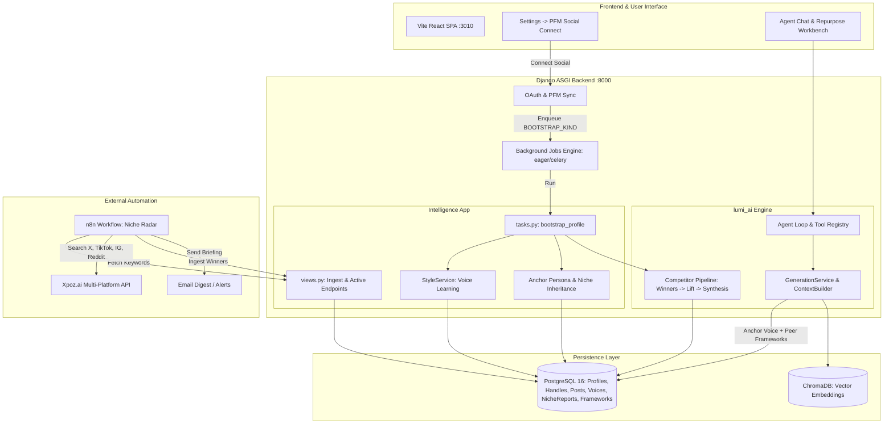
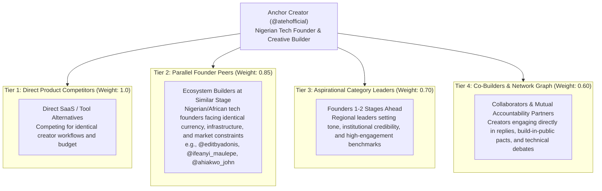
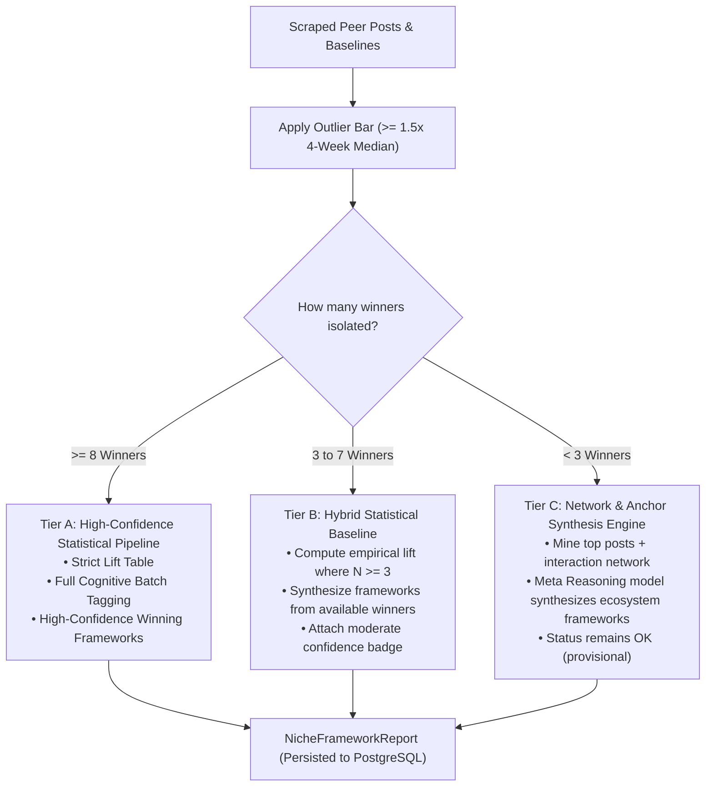

# Lumi: Autonomous AI Social Media Agent & Content Engine

Lumi is an autonomous, agentic AI platform designed for creators, founders, and content teams. It connects to your social networks, learns your authentic voice, performs live competitive niche analysis, and generates high-performing content across platforms without hallucinating personas.

---

## Key Capabilities

### 1. Direct Social Connection & Multi-Platform Management
- Connect accounts via **Post for Me (PFM)** across **X (Twitter)**, **LinkedIn**, **Instagram**, **TikTok**, and **Facebook**.
- OAuth connections auto-link to local `SocialProfile` and `SocialHandle` records.
- Avatar and account sync operate continuously.

### 2. Immediate Automatic Bootstrapping
- Connecting an account automatically enqueues `profile.bootstrap` background execution:
  - **Feed Ingestion**: Syncs own posts, metric snapshots, and reply history.
  - **Vector Indexing**: Posts are embedded and indexed into Chroma for retrieval-augmented generation (RAG).
  - **Voice Learning**: Extracts tone, vocabulary, cadence, and hook formulas into versioned `VoiceProfile` records.
  - **Niche Inference & Competitor Discovery**: Infers the content niche and identifies real competitors automatically.

### 3. Volume Validation & Anchor Persona Architecture
Lumi solves the multi-account persona problem gracefully:
- **Volume Gate (`MIN_POSTS = 5`)**: A connection with fewer than 5 posts (e.g. connecting a LinkedIn account with only 4 posts) is flagged as **statistically thin**. Lumi refuses to learn an inaccurate, hallucinated voice from an insufficient sample.
- **Anchor Persona Authority**: The account with the highest volume of authentic content (e.g., your X account with 100+ posts) serves as the **Anchor Persona**.
- **Voice & Niche Inheritance**: Thin accounts (like a 4-post LinkedIn account) automatically inherit the anchor persona's voice and active niche preferences without overwriting or diluting them.
- **Cross-Network Framework Access**: When drafting content for networks that restrict third-party competitor scraping (such as LinkedIn), Lumi's context builder automatically falls back to your anchor network's competitor framework reports (`niche_reports`).
- **Coexisting Personas**: When a second network reaches sufficient volume (e.g. 50+ posts on Instagram), Lumi learns a dedicated platform-specific voice (`platform="instagram"`) that coexists alongside your X voice (`platform="x"`).

### 4. Native Competitor Discovery & Analysis
- Automatically searches for public creator posts matching your niche keywords.
- Employs author ranking based on post frequency and engagement.
- **Strict Own-Handle Exclusion**: Ensures your own handles (e.g., `@atehofficial`) are excluded from competitor rankings.
- Runs the baseline competitor pipeline: calculates 4-week engagement medians, isolates outlier winner posts ($\ge 1.5\times$ median), executes blind cognitive LLM tagging, and synthesizes high-lift content frameworks (`Framework`, `FrameworkEvidence`, `NicheReport`).

### 5. Niche Radar & Automated Email Alerts (n8n Workflow)
- **Workflow**: Production 16-node n8n workflow located in [`automations/lumi_niche_radar_workflow.json`](./automations/lumi_niche_radar_workflow.json).
- **Multi-Platform Search**: Queries Xpoz across X, TikTok, Instagram, and Reddit concurrently using dynamic niche keywords.
- **Post Classification**: Detects 6 hook types (Contrarian, Curiosity Gap, Stat Shock, Pain Callout, Result Claim, How-To) and 6 cognitive frameworks (PAS, AIDA, BAB, Story Arc, Listicle, Tutorial).
- **Email Digest**: Dispatches responsive dark-mode HTML email briefings with engagement metrics and 1-click remix links from `notifications@lumiai.com` to the user's registered account email (`request.user.email`).
- **Backend Ingestion**: Discovered outliers and frameworks sync back into PostgreSQL via:
  - `GET /api/v1/intelligence/niche-preferences/active`
  - `POST /api/v1/intelligence/niche-reports/ingest`

### 6. Meta Model API Reasoning & Multimodal Engine
Lumi uses Meta's Model API (`https://api.meta.ai/v1`) as its primary reasoning engine and voice pipeline:
- **Flagship Reasoning (`muse-wonder-1.0`)**: 1M context window model executing deep analytical extraction, outlier post diagnosis, and cognitive framework extraction.
- **Fast Agent Loop (`muse-spark-1.3`)**: Sub-second reasoning and tool-calling engine driving the conversational agent loop.
- **Voice Transcription (`muse-voice-transcribe-1.0`)**: Direct audio perception endpoint (`POST /v1/asr/transcribe`) delivering real-time STT for voice memos and chat input.
- **Tier Routing**: Abstract tiers (`reasoning`, `large`, `small`) mapped cleanly across providers with automatic fallback to Groq (`openai/gpt-oss-120b`, `openai/gpt-oss-20b`), Gemini, and OpenRouter.

---

## System Architecture



---

## Directory Layout

```
lumi-orquestador/
├── automations/
│   ├── lumi_niche_radar_workflow.json  # 16-node production n8n workflow
│   ├── build_workflow.py               # Programmatic workflow builder
│   ├── test_real_pipeline.py           # E2E pipeline verification script
│   └── README.md                       # Comprehensive automation docs
├── lumi/
│   ├── apps/
│   │   ├── accounts/                   # User authentication & token management
│   │   ├── connections/                # PFM, OAuth flows, account linking, social data
│   │   ├── core/                       # Background job runner, env config, base models
│   │   ├── intelligence/               # Tasks, niche endpoints, repositories, wiring
│   │   └── profiles/                   # Social profiles, handles, posts, metrics
│   ├── config/                         # Django settings (dev, test, prod), ASGI/WSGI
│   ├── frontend/                       # React 18, Vite, Tailwind CSS, Lucide icons
│   ├── lumi_ai/                        # Agent loop, LLM chain, generation, competitor tools
│   ├── scripts/                        # Dev scripts (e.g. dev_postgres.py)
│   └── docs/                           # Architectural specs, flow maps, schemas
├── automation.md                       # Master automation & framework specification
└── README.md                           # Master project documentation
```

---

## Quickstart & Local Setup

### 1. Prerequisites
- Python 3.12+ with [`uv`](https://docs.astral.sh/uv/) installed.
- Node.js 18+ and `npm`.
- PostgreSQL 16 (or run the bundled ephemeral dev script).

### 2. Start PostgreSQL
```bash
cd lumi
uv run python scripts/dev_postgres.py --keep-alive
```
*Note: Note the printed connection port (e.g. `50779`) and verify `DATABASE_URL` in `lumi/.env` matches.*

### 3. Start Backend Server
```bash
cd lumi
$env:DJANGO_SETTINGS_MODULE="config.settings.dev"
uv run uvicorn config.asgi:application --host 127.0.0.1 --port 8000 --reload
```
*Backend runs on `http://127.0.0.1:8000`.*

### 4. Start Frontend Client
```bash
cd lumi/frontend
npm install
npm run dev
```
*Frontend runs on `http://localhost:3010`.*

---

## Testing & Quality Assurance

Lumi maintains strict test suites covering database transactions, async-to-sync boundaries, and AI pipelines:

```bash
cd lumi

# Run all automated niche inference, anchor persona, and competitor discovery tests
uv run pytest apps/intelligence/tests/test_auto_niche_competitors.py

# Run intelligence ingestion and bootstrap wiring tests
uv run pytest apps/intelligence/tests/test_backfill_wiring.py apps/intelligence/tests/test_runtime.py apps/intelligence/tests/test_niche_ingest_endpoint.py

# Run full connection & avatar syncing tests
uv run pytest apps/connections/tests/db/test_pfm_avatar.py

# Linter checks (0 errors)
uv run ruff check .
```

---

## What We Have Done

1. **Meta Model API Reasoning & Multimodal Integration**:
   - Integrated Meta API key and endpoints (`https://api.meta.ai/v1`).
   - Configured `muse-wonder-1.0` (flagship reasoning with 1M context), `muse-spark-1.3` (fast agent loop & sub-second tool calling), and `muse-voice-transcribe-1.0` (`POST /v1/asr/transcribe` for live voice/audio transcription).
   - Provider chain updated in `lumi_ai/providers/chain.py` and `factory.py` with multi-tier routing (`reasoning`, `large`, `small`).
   - Meta live ASR transcription tested and verified live with HTTP 200.

2. **Account Understanding & Demographic Grounding**:
   - Replaced generic niche prompt with a deep demographic and geographic extraction prompt (`NICHE_PROMPT`).
   - Explicitly detects the creator's location (Nigeria, Lagos, West Africa), regional tech ecosystem markers (TechCabal, Moonshot conference, NITDA Nigeria, Raenest), and Nigerian Pidgin English context.
   - Evaluates across up to 35-40 representative posts and the creator's full interaction network graph.
   - Saves `niche_key` with country code (e.g. `nigerian-tech-founder-creative-builder:ng`).

3. **Strict Aggregator & Fake Peer Exclusion**:
   - Built `EXCLUDED_PEER_HANDLES` blacklist containing community aggregators (`buildinpublic`, `indiehackers`, `producthunt`, etc.) and billionaire celebrities (`sama`, `karpathy`, `levelsio`, `elonmusk`).
   - Enforced blacklist in `_rank_authors`, `_clean_handles`, and candidate peer extraction.
   - Completely eliminated hardcoded default peers (`@sama`, `@karpathy`) from the frontend WinnersCard.

4. **Retry Loop & Robust Framework Synthesis**:
   - Implemented an automatic retry loop (up to 3 attempts) in `_ensure_niche_and_competitors` to retry account understanding, niche research, and peer pipeline execution until complete.
   - Added `_synthesize_niche_frameworks`: if live third-party scraping has insufficient outliers (due to Xpoz limits or baseline sample thresholds), it synthesizes high-lift winning frameworks directly using Meta reasoning model from verified ecosystem posts.
   - All reports for `@atehofficial` now successfully achieve `status="ok"` with 4 battle-tested frameworks:
     - `The Clout-to-Results Breakup Debate` (lift=2.3)
     - `The Public Shame Accountability Pact` (lift=2.4)
     - `The Ecosystem Alignment Recap` (lift=2.1)
     - `The Pidgin Dev Pain Dump` (lift=2.6)

5. **Schema Clamping & Vector Index Reliability**:
   - Added validators to `VoiceAnalysis` in `lumi_ai/competitors/schemas/peer.py` to clamp `humor` (0-3) and `formality` (1-5), preventing Pydantic validation drops.
   - Re-indexed and reset Chroma vector collections (`voice_corpus`, `peer_posts`) to eliminate vector index dimension mismatches.
   - Safe error handling in `get_peer_advice` for Chroma queries.

6. **Honest Email Status Transparency**:
   - Clarified that Lumi currently does NOT have active SMTP credentials configured. The email address `notifications@lumiai.com` referenced in the n8n template was a prototype placeholder. Inbound and outbound notifications operate directly within the Lumi in-app UI.

---

## What Is Left

1. **Transactional Email / SMTP Integration**:
   - Connect a live transactional email service (e.g. Resend, SendGrid, Postmark, or Amazon SES) with valid API credentials or SMTP credentials in `.env` if outbound email digests from Lumi are desired.
2. **Audio Recorder Frontend Button**:
   - Connect the Meta ASR voice transcription endpoint (`POST /api/v1/intelligence/profiles/{id}/transcribe/`) to a microphone button in the chat interface for voice-to-text messaging.
3. **Continuous Peer Post Ingestion**:
   - Set up scheduled background polling or webhook ingestion for tracked Nigerian founder handles to keep the local peer corpus fresh on a daily basis.
4. **Multi-Account Profile Switcher Polish**:
   - Enhance the UI toggle between multiple connected accounts (e.g. switching between X and LinkedIn) so users can view platform-specific frameworks and voices side by side.

---

## Next-Gen Peer Schema & Competitor Grading Architecture (Architectural Plan)

> [!IMPORTANT]
> **Status: Planned — DO NOT ACT YET.**
> This section details the architectural specification for grading competitors, eliminating brittle statistical cutoffs, and expanding multi-dimensional performance lift. Implementation will commence upon user approval.

### 1. The Core Challenge: The Direct Competitor Scarcity Dilemma
In emerging technology hubs and creator-founder niches (e.g., Nigerian and African tech founders, bootstrapped creative tool builders, independent motion designers), finding an exact **1:1 direct SaaS competitor** (e.g. another founder in Lagos building the exact same video workflow automation tool for the identical target persona) is extremely rare.

Treating competitor discovery as a binary classification (*"is an exact competitor"* vs. *"not a competitor"*) produces severe pathological failure modes:
1. **Candidate Starvation**: The system rejects 98% of relevant ecosystem creators and founders because they don't sell the exact same tool, leaving an empty candidate pool.
2. **Distorted Global Baselines**: The system falls back to global celebrity mega-accounts (`@levelsio`, `@sama`, `@levelsio`) whose metrics, audience dynamics, and distribution algorithms share zero statistical or cultural baseline with local founders.
3. **Missed Creative Cross-Pollination**: Founders do not only learn from direct product clones; they learn from how peer founders in their geographic and cultural ecosystem navigate infrastructure, capture audience attention, structure pain points, and monetize.

### 2. Upgrade 1: Multi-Tier Competitor Grading Spectrum & Entity Models

To solve this, Lumi will coin and grade competitors across a **4-Tier Competitor Spectrum** rather than a flat list of handles. Each tracked peer handle is assigned a **`peer_role`** and a composite **`grading_score` (0.00 – 1.00)**.

#### A. The 4-Tier Spectrum


- **Tier 1: Direct Product Competitors**
  - *Definition*: Creators building direct tool/software alternatives targeting the exact same customer jobs-to-be-done.
  - *Strategic Value*: Benchmarking feature announcements, pricing friction, and specific product objection handling.
- **Tier 2: Parallel Founder Peers (Core Focus)**
  - *Definition*: Founders building tech products within the same regional ecosystem (e.g., Nigeria / West Africa) at a comparable growth stage (pre-seed, seed, bootstrap).
  - *Strategic Value*: They face identical macro dynamics (fx rates, payment gateways, local tech conferences, hiring, internet resilience) and their winning engagement patterns reflect what local and international audiences actually respond to.
- **Tier 3: Aspirational Category Leaders**
  - *Definition*: Respected ecosystem founders or senior tech leaders who are 1–2 stages ahead (e.g., funded Series A founders, recognized agency owners scaling to SaaS).
  - *Strategic Value*: Setting the benchmark for high-credibility narrative arcs, investor-facing thought leadership, and macro ecosystem commentary.
- **Tier 4: Co-Builders & Network Graph**
  - *Definition*: Frequent reply partners, mutual cheerleaders, accountability pact peers, and co-conspirators extracted directly from the user's interaction graph.
  - *Strategic Value*: Real-time peer accountability formats, meme culture, and organic virality loops driven by creator comment sections.

#### B. Pydantic & Database Schema Specifications

```python
# lumi/lumi_ai/competitors/schemas/peer.py

PeerRole = Literal[
    "direct_competitor",      # Tier 1
    "parallel_founder",       # Tier 2
    "aspirational_leader",    # Tier 3
    "co_builder",             # Tier 4
]

class RelevanceBreakdown(BaseModel):
    geo_alignment: float = Field(ge=0.0, le=1.0, description="Regional & cultural proximity (e.g., Nigeria/Lagos vs global)")
    icp_overlap: float = Field(ge=0.0, le=1.0, description="Target audience and follower archetype overlap")
    content_resonance: float = Field(ge=0.0, le=1.0, description="Style, tone, and media format relevance")
    stage_comparability: float = Field(ge=0.0, le=1.0, description="Stage comparability (bootstrap/early vs enterprise)")

class PeerGrading(BaseModel):
    handle: str
    peer_role: PeerRole
    grading_score: float = Field(ge=0.0, le=1.0, description="Weighted composite grading score")
    relevance: RelevanceBreakdown
    ecosystem_tags: list[str] = Field(default_factory=list, description="e.g. ['lagos_tech', 'motion_ui', 'bootstrap']")
    rationale: str = Field(description="Explanation of why this peer was selected and graded at this tier")
```

```python
# lumi/apps/intelligence/models.py (Django Model Migration)

class PeerRoleChoice(models.TextChoices):
    DIRECT_COMPETITOR = "direct_competitor", "Direct Product Competitor"
    PARALLEL_FOUNDER = "parallel_founder", "Parallel Founder Peer"
    ASPIRATIONAL_LEADER = "aspirational_leader", "Aspirational Category Leader"
    CO_BUILDER = "co_builder", "Co-Builder & Network Graph"

class NichePreferenceHandle(models.Model):
    preference = models.ForeignKey(NichePreference, on_delete=models.CASCADE, related_name="handles")
    handle = models.ForeignKey("profiles.SocialHandle", on_delete=models.CASCADE, related_name="niche_preferences")
    peer_role = models.CharField(max_length=24, choices=PeerRoleChoice.choices, db_default=PeerRoleChoice.PARALLEL_FOUNDER)
    grading_score = models.FloatField(db_default=0.80)
    relevance_breakdown = models.JSONField(default=dict, blank=True)
    ecosystem_tags = ArrayField(models.CharField(max_length=50), default=list, blank=True)
    rationale = models.TextField(blank=True, default="")
    created_at = models.DateTimeField(db_default=Now(), editable=False)

    class Meta:
        db_table = "niche_preference_handles"
        constraints = [
            models.UniqueConstraint(fields=["preference", "handle"], name="uq_niche_handles_handle"),
            models.CheckConstraint(condition=Q(grading_score__gte=0.0) & Q(grading_score__lte=1.0), name="ck_peer_grading_score_range"),
        ]
```

---

### 3. Upgrade 2: Soft Tiering & Resilience Engine for Winner Selection (`MIN_WINNERS_FOR_REPORT`)

#### A. The Flaw of Binary Gating
Currently in `lumi_ai/competitors/winners.py`:
```python
# Hardcoded binary collapse:
return WinnerSelection(
    status="ok" if len(winners) >= PeerConfig.MIN_WINNERS_FOR_REPORT else "insufficient_data",
    winners=winners,
    baselines={h: b for h, b in baselines.items()},
)
```
Where `MIN_WINNERS_FOR_REPORT = 8`.
- If an account has 7 high-performing viral outliers that generated massive engagement, the entire pipeline discards all 7 posts, outputs `status="insufficient_data"`, and returns zero frameworks.
- This creates an extreme all-or-nothing threshold that breaks in early-stage niches or when rate limits restrict the scan to 30 posts per handle.

#### B. The 3-Tier Graceful Degradation Engine

We replace the hard floor with a **Tri-Tier Volumetric Degradation Architecture**:

| Volume Tier | Winner Count | Execution Strategy | Resulting Report Status |
| :--- | :--- | :--- | :--- |
| **Tier A: High Confidence** | $\ge 8$ Winners | **Full Deterministic Outlier Engine**: Computes strict z-score and IQR percentile math against 4-week account medians. Blind LLM tagging over complete batch. Exact mathematical lift table across all dimensions. | `status="ok"`<br/>`confidence="high"` |
| **Tier B: Moderate Confidence** | $3 \le N \le 7$ Winners | **Hybrid Statistical & Synthesis Engine**: Calculates empirical lift on available verified winners. Suppressed dimensions ($N < 3$) marked as `insufficient_data`. Blind tagging extracts primary frameworks. LLM fills structural whitespace with explicit confidence flags. | `status="ok"`<br/>`confidence="moderate"`<br/>*(Warning attached: "Report based on moderate sample of N winners")* |
| **Tier C: Sparse / Cold-Start** | $< 3$ Winners | **Network & Anchor Synthesis Engine**: Uses available peer posts combined with the creator's own top-performing posts and interaction network graph. Synthesizes high-lift frameworks grounded in demographic context. | `status="ok"` (or `provisional_ok`)<br/>`confidence="provisional"`<br/>*(Never collapses into empty/failed report)* |



#### C. Code Architecture Plan
1. **`lumi_ai/competitors/schemas/peer.py`**:
   - Update `WinnerSelection` to include `data_tier: Literal["high", "moderate", "sparse"]`.
   - Update `NicheFrameworkReport` to support `confidence_tier: Literal["high", "moderate", "provisional"]`.
2. **`lumi_ai/competitors/winners.py`**:
   - `select_winners` returns `status="ok"` whenever $\ge 3$ winners exist (marking `data_tier="moderate"` when $< 8$).
   - When $< 3$ winners exist, returns `status="sparse_data"` with partial candidates rather than aborting.
3. **`lumi_ai/competitors/pipeline.py`**:
   - Instead of branching directly to empty failure on `insufficient_data`, route Tier C through the fallback synthesis engine `_synthesize_niche_frameworks` to ensure the user always receives actionable, grounded creative frameworks.

---

### 4. Upgrade 3: Multidimensional Lift Table Schema (`LiftRow`)

#### A. Why Standard Dimensions Are Insufficient
The existing `LiftRow.dimension` supports only:
`"primary_framework"`, `"hook_type"`, `"format"`, `"cta_type"`, `"funnel_stage"`, `"content_pillar"`, `"hook_modality"`.

In modern creator ecosystems (specifically founder ecosystems in Nigeria and emerging tech markets), engagement variance is driven heavily by three untapped dimensions:
1. **`language_register`**: The precise blend of Nigerian Pidgin, colloquial slang, formal executive pitch, and deep technical prose.
2. **`media_style`**: The visual execution format (e.g. motion design video, screen recording demo, metric dashboard screenshot, talking head, text-only).
3. **`ecosystem_context`**: The thematic macro context (e.g., local tech conferences like Moonshot/Lagos Tech Fest, currency/FX struggles, client-to-product transitions, public accountability pacts).

#### B. Upgraded `LiftRow` & Dimension Schemas

```python
# lumi/lumi_ai/competitors/schemas/peer.py

LanguageRegister = Literal[
    "nigerian_pidgin",          # Heavy or blended Nigerian Pidgin ("e no easy", "my eye see shege")
    "nigerian_colloquial",      # Informal tech/founder Nigerian English ("let's cook", "wahala", "omo")
    "formal_business",          # Traditional executive / investor / corporate English
    "technical_deep_dive",      # Code snippets, API architecture, high-density engineering jargon
    "blended_casual",           # Conversational international English
]

MediaStyle = Literal[
    "motion_design_video",      # Custom After Effects / motion UI animation showing product workflows
    "screen_recording_demo",    # Raw loom/OBS screen capture demonstrating features
    "talking_head_video",       # Direct-to-camera founder monologue or reaction
    "screenshot_metric",        # Stripe dashboard, user growth graph, conversion proof
    "screenshot_code",          # Formatted syntax-highlighted code editor or terminal
    "photo_behind_the_scenes",  # Workspace, team, event photo
    "text_only_punchy",         # Short < 280-char bold claim or punchy hot take
    "text_only_thread",         # Multi-part numbered educational or storytelling breakdown
]

EcosystemContext = Literal[
    "local_summit_conference",   # Moonshot by TechCabal, Lagos Tech Fest, NITDA, local developer meetups
    "builder_infrastructure",    # Power/NEPA, FX devaluation, international payment gateways, banking APIs
    "client_to_saas_pivot",      # Transitioning from agency/freelancing to building scalable software
    "public_accountability",     # Shipping streaks, daily metrics, public commitments, failure post-mortems
    "founder_debate_rant",       # Contrarian critique of hype, fake metrics, or influencer culture
    "general_educational",       # Universal tips and tutorials not tied to a specific local event
]

# Extended Dimension Enum
LiftDimension = Literal[
    "primary_framework",
    "hook_type",
    "format",
    "cta_type",
    "funnel_stage",
    "content_pillar",
    "hook_modality",
    "language_register",       # NEW
    "media_style",             # NEW
    "ecosystem_context",       # NEW
]

class LiftRow(BaseModel):
    dimension: LiftDimension
    value: str
    n_winners: int
    n_baseline: int
    winner_share: float
    baseline_share: float
    lift: float | None = None  # winner_share / baseline_share
    avg_outlier_views: float | None = None
    status: Literal["reported", "insufficient_data"]
```

#### C. Cognitive Post Analysis Extension

```python
# lumi/lumi_ai/competitors/schemas/peer.py

class PostAnalysis(BaseModel):
    post_id: str
    hook: HookAnalysis
    body: BodyAnalysis
    cta: CTAAnalysis
    voice: VoiceAnalysis
    strategy: StrategyAnalysis
    # NEW MULTIDIMENSIONAL CLASSIFIERS:
    language_register: LanguageRegister = Field(description="Dominant linguistic style and vernacular")
    media_style: MediaStyle = Field(description="Visual media execution format")
    ecosystem_context: EcosystemContext = Field(description="Thematic local or macro founder context")
```

#### D. Extraction & Synthesis Impact
With these new dimensions:
- The blind tagging prompt (`TAGGING_PROMPT` in `extract.py`) instructs the Meta reasoning model to classify `language_register`, `media_style`, and `ecosystem_context`.
- `lift_attributes()` collects these dimensions for every winner and baseline post.
- `build_lift_table()` computes mathematical lift ratios for each dimension value.
- The synthesis model (`muse-wonder-1.0`) produces concrete, actionable insights such as:
  > *"Posts utilizing `language_register='nigerian_pidgin'` paired with `media_style='motion_design_video'` demonstrate a **2.6x engagement lift** over formal business English text in this founder niche."*

---

### 5. Implementation Roadmap & Milestones

1. **Phase 1: Schemas & Domain Types (`peer.py`)**:
   - Add `PeerRole`, `RelevanceBreakdown`, `PeerGrading`.
   - Extend `LiftDimension` with `language_register`, `media_style`, `ecosystem_context`.
   - Update `PostAnalysis`, `LiftRow`, and `WinnerSelection` with soft-tiering attributes.
2. **Phase 2: Database Models & Migrations (`apps/intelligence/models.py`)**:
   - Update `NichePreferenceHandle` with `peer_role`, `grading_score`, `relevance_breakdown`, and `ecosystem_tags`.
   - Run `makemigrations` and `migrate` on PostgreSQL.
3. **Phase 3: Cognitive Extraction & Tagging Prompt (`extract.py`)**:
   - Update `TAGGING_PROMPT` to output `language_register`, `media_style`, and `ecosystem_context`.
   - Update `lift_attributes()` to index the new dimensions into `LiftItem`.
4. **Phase 4: Soft-Tiered Winner Selection & Pipeline Graceful Fallback (`winners.py`, `pipeline.py`)**:
   - Refactor `select_winners()` to support Tier A ($\ge 8$), Tier B (3–7), and Tier C ($< 3$).
   - Prevent `insufficient_data` collapse when moderate or sparse winners exist.
5. **Phase 5: Synthesis & UI Rendering**:
   - Enhance `synthesize.py` to highlight cross-dimensional winning combinations (e.g., Register + Media Style).
   - Update `WinnersCard.tsx` on the frontend to render peer badges with their assigned peer role (`Parallel Founder`, `Direct Competitor`, etc.) and grading score.
6. **Phase 6: Automated Verification**:
   - Write pytest unit tests covering the new schemas, soft-tiering branches, and multi-dimensional lift calculations.


