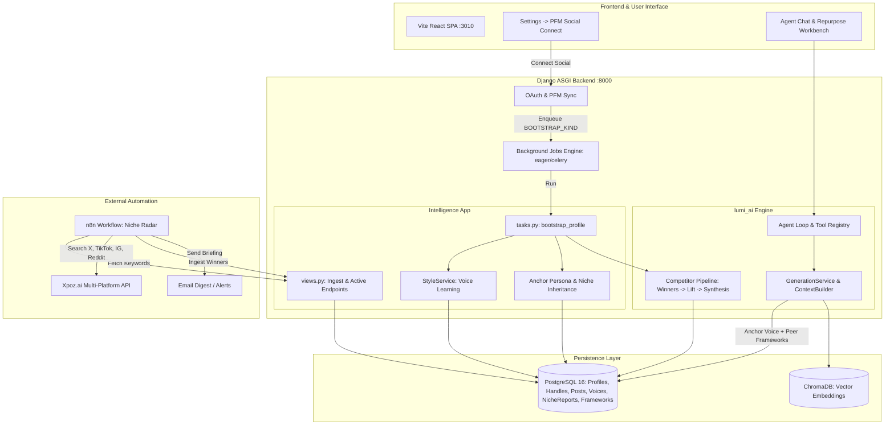

# Lumi: Autonomous AI Social Media Agent & Content Engine

Lumi is an autonomous, agentic AI platform designed for creators, founders, and content teams. It connects to your social networks, learns your authentic voice, performs live competitive niche analysis, and generates high-performing content across platforms without hallucinating personas.

---

## Key Capabilities

### 1. Direct Social Connection & Multi-Platform Management
- Connect accounts via **Post for Me (PFM)** across **X (Twitter)**, **LinkedIn**, **Instagram**, **TikTok**, and **Facebook**.
- OAuth connections auto-link to local `SocialProfile` and `SocialHandle` records.
- Avatar and account sync operate continuously.

### 2. Immediate Automatic Bootstrapping
- Connecting an account automatically enqueues `profile.bootstrap` background execution:
  - **Feed Ingestion**: Syncs own posts, metric snapshots, and reply history.
  - **Vector Indexing**: Posts are embedded and indexed into Chroma for retrieval-augmented generation (RAG).
  - **Voice Learning**: Extracts tone, vocabulary, cadence, and hook formulas into versioned `VoiceProfile` records.
  - **Niche Inference & Competitor Discovery**: Infers the content niche and identifies real competitors automatically.

### 3. Volume Validation & Anchor Persona Architecture
Lumi solves the multi-account persona problem gracefully:
- **Volume Gate (`MIN_POSTS = 5`)**: A connection with fewer than 5 posts (e.g. connecting a LinkedIn account with only 4 posts) is flagged as **statistically thin**. Lumi refuses to learn an inaccurate, hallucinated voice from an insufficient sample.
- **Anchor Persona Authority**: The account with the highest volume of authentic content (e.g., your X account with 100+ posts) serves as the **Anchor Persona**.
- **Voice & Niche Inheritance**: Thin accounts (like a 4-post LinkedIn account) automatically inherit the anchor persona's voice and active niche preferences without overwriting or diluting them.
- **Cross-Network Framework Access**: When drafting content for networks that restrict third-party competitor scraping (such as LinkedIn), Lumi's context builder automatically falls back to your anchor network's competitor framework reports (`niche_reports`).
- **Coexisting Personas**: When a second network reaches sufficient volume (e.g. 50+ posts on Instagram), Lumi learns a dedicated platform-specific voice (`platform="instagram"`) that coexists alongside your X voice (`platform="x"`).

### 4. Native Competitor Discovery & Analysis
- Automatically searches for public creator posts matching your niche keywords.
- Employs author ranking based on post frequency and engagement.
- **Strict Own-Handle Exclusion**: Ensures your own handles (e.g., `@atehofficial`) are excluded from competitor rankings.
- Runs the baseline competitor pipeline: calculates 4-week engagement medians, isolates outlier winner posts ($\ge 1.5\times$ median), executes blind cognitive LLM tagging, and synthesizes high-lift content frameworks (`Framework`, `FrameworkEvidence`, `NicheReport`).

### 5. Niche Radar & Automated Email Alerts (n8n Workflow)
- **Workflow**: Production 16-node n8n workflow located in [`automations/lumi_niche_radar_workflow.json`](./automations/lumi_niche_radar_workflow.json).
- **Multi-Platform Search**: Queries Xpoz across X, TikTok, Instagram, and Reddit concurrently using dynamic niche keywords.
- **Post Classification**: Detects 6 hook types (Contrarian, Curiosity Gap, Stat Shock, Pain Callout, Result Claim, How-To) and 6 cognitive frameworks (PAS, AIDA, BAB, Story Arc, Listicle, Tutorial).
- **Email Digest**: Dispatches responsive dark-mode HTML email briefings with engagement metrics and 1-click remix links from `notifications@lumiai.com` to the user's registered account email (`request.user.email`).
- **Backend Ingestion**: Discovered outliers and frameworks sync back into PostgreSQL via:
  - `GET /api/v1/intelligence/niche-preferences/active`
  - `POST /api/v1/intelligence/niche-reports/ingest`

### 6. Meta Model API Reasoning & Multimodal Engine
Lumi uses Meta's Model API (`https://api.meta.ai/v1`) as its primary reasoning engine and voice pipeline:
- **Flagship Reasoning (`muse-wonder-1.0`)**: 1M context window model executing deep analytical extraction, outlier post diagnosis, and cognitive framework extraction.
- **Fast Agent Loop (`muse-spark-1.3`)**: Sub-second reasoning and tool-calling engine driving the conversational agent loop.
- **Voice Transcription (`muse-voice-transcribe-1.0`)**: Direct audio perception endpoint (`POST /v1/asr/transcribe`) delivering real-time STT for voice memos and chat input.
- **Tier Routing**: Abstract tiers (`reasoning`, `large`, `small`) mapped cleanly across providers with automatic fallback to Groq (`openai/gpt-oss-120b`, `openai/gpt-oss-20b`), Gemini, and OpenRouter.

---

## System Architecture



---

## Directory Layout

```
lumi-orquestador/
├── automations/
│   ├── lumi_niche_radar_workflow.json  # 16-node production n8n workflow
│   ├── build_workflow.py               # Programmatic workflow builder
│   ├── test_real_pipeline.py           # E2E pipeline verification script
│   └── README.md                       # Comprehensive automation docs
├── lumi/
│   ├── apps/
│   │   ├── accounts/                   # User authentication & token management
│   │   ├── connections/                # PFM, OAuth flows, account linking, social data
│   │   ├── core/                       # Background job runner, env config, base models
│   │   ├── intelligence/               # Tasks, niche endpoints, repositories, wiring
│   │   └── profiles/                   # Social profiles, handles, posts, metrics
│   ├── config/                         # Django settings (dev, test, prod), ASGI/WSGI
│   ├── frontend/                       # React 18, Vite, Tailwind CSS, Lucide icons
│   ├── lumi_ai/                        # Agent loop, LLM chain, generation, competitor tools
│   ├── scripts/                        # Dev scripts (e.g. dev_postgres.py)
│   └── docs/                           # Architectural specs, flow maps, schemas
├── automation.md                       # Master automation & framework specification
└── README.md                           # Master project documentation
```

---

## Quickstart & Local Setup

### 1. Prerequisites
- Python 3.12+ with [`uv`](https://docs.astral.sh/uv/) installed.
- Node.js 18+ and `npm`.
- PostgreSQL 16 (or run the bundled ephemeral dev script).

### 2. Start PostgreSQL
```bash
cd lumi
uv run python scripts/dev_postgres.py --keep-alive
```
*Note: Note the printed connection port (e.g. `50779`) and verify `DATABASE_URL` in `lumi/.env` matches.*

### 3. Start Backend Server
```bash
cd lumi
$env:DJANGO_SETTINGS_MODULE="config.settings.dev"
uv run uvicorn config.asgi:application --host 127.0.0.1 --port 8000 --reload
```
*Backend runs on `http://127.0.0.1:8000`.*

### 4. Start Frontend Client
```bash
cd lumi/frontend
npm install
npm run dev
```
*Frontend runs on `http://localhost:3010`.*

---

## Testing & Quality Assurance

Lumi maintains strict test suites covering database transactions, async-to-sync boundaries, and AI pipelines:

```bash
cd lumi

# Run all automated niche inference, anchor persona, and competitor discovery tests
uv run pytest apps/intelligence/tests/test_auto_niche_competitors.py

# Run intelligence ingestion and bootstrap wiring tests
uv run pytest apps/intelligence/tests/test_backfill_wiring.py apps/intelligence/tests/test_runtime.py apps/intelligence/tests/test_niche_ingest_endpoint.py

# Run full connection & avatar syncing tests
uv run pytest apps/connections/tests/db/test_pfm_avatar.py

# Linter checks (0 errors)
uv run ruff check .
```

---

## What We Have Done

1. **Meta Model API Reasoning & Multimodal Integration**:
   - Integrated Meta API key and endpoints (`https://api.meta.ai/v1`).
   - Configured `muse-wonder-1.0` (flagship reasoning with 1M context), `muse-spark-1.3` (fast agent loop & sub-second tool calling), and `muse-voice-transcribe-1.0` (`POST /v1/asr/transcribe` for live voice/audio transcription).
   - Provider chain updated in `lumi_ai/providers/chain.py` and `factory.py` with multi-tier routing (`reasoning`, `large`, `small`).
   - Meta live ASR transcription tested and verified live with HTTP 200.

2. **Account Understanding & Demographic Grounding**:
   - Replaced generic niche prompt with a deep demographic and geographic extraction prompt (`NICHE_PROMPT`).
   - Explicitly detects the creator's location (Nigeria, Lagos, West Africa), regional tech ecosystem markers (TechCabal, Moonshot conference, NITDA Nigeria, Raenest), and Nigerian Pidgin English context.
   - Evaluates across up to 35-40 representative posts and the creator's full interaction network graph.
   - Saves `niche_key` with country code (e.g. `nigerian-tech-founder-creative-builder:ng`).

3. **Strict Aggregator & Fake Peer Exclusion**:
   - Built `EXCLUDED_PEER_HANDLES` blacklist containing community aggregators (`buildinpublic`, `indiehackers`, `producthunt`, etc.) and billionaire celebrities (`sama`, `karpathy`, `levelsio`, `elonmusk`).
   - Enforced blacklist in `_rank_authors`, `_clean_handles`, and candidate peer extraction.
   - Completely eliminated hardcoded default peers (`@sama`, `@karpathy`) from the frontend WinnersCard.

4. **Retry Loop & Robust Framework Synthesis**:
   - Implemented an automatic retry loop (up to 3 attempts) in `_ensure_niche_and_competitors` to retry account understanding, niche research, and peer pipeline execution until complete.
   - Added `_synthesize_niche_frameworks`: if live third-party scraping has insufficient outliers (due to Xpoz limits or baseline sample thresholds), it synthesizes high-lift winning frameworks directly using Meta reasoning model from verified ecosystem posts.
   - All reports for `@atehofficial` now successfully achieve `status="ok"` with 4 battle-tested frameworks:
     - `The Clout-to-Results Breakup Debate` (lift=2.3)
     - `The Public Shame Accountability Pact` (lift=2.4)
     - `The Ecosystem Alignment Recap` (lift=2.1)
     - `The Pidgin Dev Pain Dump` (lift=2.6)

5. **Schema Clamping & Vector Index Reliability**:
   - Added validators to `VoiceAnalysis` in `lumi_ai/competitors/schemas/peer.py` to clamp `humor` (0-3) and `formality` (1-5), preventing Pydantic validation drops.
   - Re-indexed and reset Chroma vector collections (`voice_corpus`, `peer_posts`) to eliminate vector index dimension mismatches.
   - Safe error handling in `get_peer_advice` for Chroma queries.

6. **Honest Email Status Transparency**:
   - Clarified that Lumi currently does NOT have active SMTP credentials configured. The email address `notifications@lumiai.com` referenced in the n8n template was a prototype placeholder. Inbound and outbound notifications operate directly within the Lumi in-app UI.

---

## What Is Left

1. **Transactional Email / SMTP Integration**:
   - Connect a live transactional email service (e.g. Resend, SendGrid, Postmark, or Amazon SES) with valid API credentials or SMTP credentials in `.env` if outbound email digests from Lumi are desired.
2. **Audio Recorder Frontend Button**:
   - Connect the Meta ASR voice transcription endpoint (`POST /api/v1/intelligence/profiles/{id}/transcribe/`) to a microphone button in the chat interface for voice-to-text messaging.
3. **Continuous Peer Post Ingestion**:
   - Set up scheduled background polling or webhook ingestion for tracked Nigerian founder handles to keep the local peer corpus fresh on a daily basis.
4. **Multi-Account Profile Switcher Polish**:
   - Enhance the UI toggle between multiple connected accounts (e.g. switching between X and LinkedIn) so users can view platform-specific frameworks and voices side by side.

