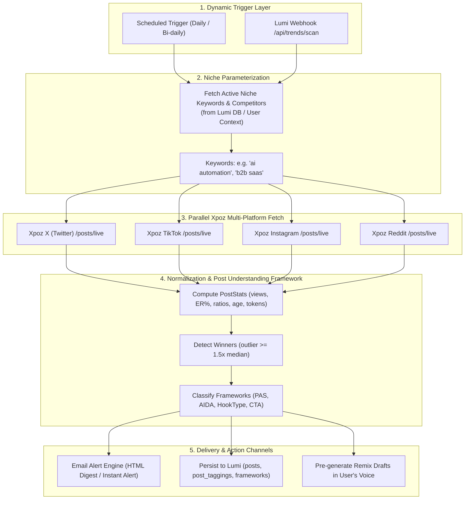

# Niche Discovery & Email Alert Automation Plan

> **Reference File**: [`c:\Users\USER\Downloads\n8n Lumi.txt`](file:///c:/Users/USER/Downloads/n8n%20Lumi.txt)  
> **Source Platform**: n8n Workflow (JSON export `c0a67a94c446d58be0319939264b0b1aff6d4de989b750a9f97afc0bd57b41a8`)  
> **Data Provider**: Xpoz.ai Live Search API (`api.xpoz.ai/api/data/{platform}/posts/live`)  
> **Target System**: Lumi Intelligence & Competitor Framework Pipeline  

---

## 1. Executive Summary & Assessment of Current Workflow

The baseline workflow in `n8n Lumi.txt` queries Xpoz.ai across 4 platforms (**Instagram**, **TikTok**, **X / Twitter**, and **Reddit**) in parallel and normalizes them into basic JSON objects.

### Current Limitations:
1. **Hardcoded Query**: The keyword `"marketing"` is hardcoded in every HTTP node.
2. **Disconnected from User Niches**: It does not read the active user's niche keywords (`niche_preference_keywords`) or tracked competitor handles (`niche_preference_handles`).
3. **Basic Data Schema**: Captures only raw engagement counts (`likes`, `comments`, `impressions`) without semantic structure. It lacks post format classification, hook type detection, framework extraction (PAS, AIDA, Story), and winner filtering.
4. **No Notification / Delivery Channel**: Results stop in n8n memory without delivering an email brief or triggering Lumi drafts.

---

## 2. Upgraded Architecture & Data Flow



---

## 3. Dynamic Niche Parameterization

Instead of hardcoding `q="marketing"`, the workflow will be parameterized to receive:
- **`keywords`**: String array extracted from `NichePreferenceKeyword` (e.g. `["b2b saas", "growth marketing", "cold outreach"]`).
- **`handles`**: Target competitor `@handles` from `NichePreferenceHandle`.
- **`recipient_email`**: The user's notification email address.
- **`profile_id`**: Active `SocialProfile` ID in Lumi.

### Implementation Options in n8n:
1. **Webhook Trigger Mode (`POST /webhook/lumi-niche-scan`)**:
   - Lumi backend dispatches a webhook payload on schedule or on-demand:
     ```json
     {
       "profile_id": 42,
       "email": "creator@example.com",
       "niche_title": "AI & Growth",
       "keywords": ["ai automation", "agentic workflows", "llm in production"],
       "handles": ["@sama", "@karpathy", "@rowancheung"],
       "alert_threshold": 1.8
     }
     ```
2. **HTTP Request Node to Lumi Backend**:
   - A scheduled cron node in n8n queries `GET https://app.lumiai.com/api/intelligence/niche-preferences/active` using an internal API secret to fetch all profiles that requested email briefings.

In the Xpoz HTTP request nodes, the query parameter becomes:
```text
q = {{ $json.keywords ? $json.keywords.map(k => `"${k}"`).join(' OR ') : 'marketing' }}
```

---

## 4. Enhanced Post Understanding Schema (Matching Lumi Production)

The current schema in `n8n Lumi.txt` will be upgraded from flat counters to Lumi's full **`PostStats`** and **`PostAnalysis`** schema (`lumi/lumi_ai/competitors/schemas/peer.py`):

### A. Scraped & Computed Metrics (`PostStats`)

| Field | Type | Description / Logic |
|---|---|---|
| `post_id` | `string` | Unique platform post ID (cleaned of Reddit `t3_` prefix) |
| `platform` | `'x' \| 'tiktok' \| 'instagram' \| 'reddit'` | Normalized platform identifier |
| `author` | `object` | `{ handle, display_name, avatar_url }` |
| `text` | `string` | Full text / caption / title + selftext |
| `url` | `string` | Canonical direct link (e.g. `https://x.com/{author}/status/{id}`, `https://redd.it/{id}`) |
| `published_at` | `ISO 8601 string` | Accurate publication date (using TikTok snowflake decoding fallback) |
| `age_hours` | `float` | `(now - published_at) / 3600` |
| `format` | `enum` | `'single' \| 'multi_image' \| 'video' \| 'thread' \| 'quote_post' \| 'long_form'` |
| `views` | `int \| null` | Impression / view count |
| `likes` | `int` | Like / upvote count |
| `comments` | `int` | Reply / comment count |
| `reposts` | `int` | Retweet / share count |
| `engagement_total` | `int` | Sum of verified engagements (`likes + comments + reposts`) |
| `engagement_rate` | `float \| null` | `(engagement_total / views) * 100` (when views are present) |
| `outlier_score` | `float` | Multiplier relative to peer median (e.g. `2.4x`) |
| `is_winner` | `boolean` | `true` if `outlier_score >= 1.5` and `age_hours >= 24` |

### B. Cognitive / Framework Layer (`PostAnalysis`)

For high-performing outlier posts (`is_winner === true`), run a lightweight LLM classification step (via n8n AI Agent node, Groq, or OpenAI) to extract:

1. **Hook Analysis**:
   - `hook_text`: Verbatim first line or first 140 characters.
   - `hook_type`:
     - `curiosity_gap` ("Most creators do X. Here is why they fail...")
     - `contrarian` ("Stop using ChatGPT for copywriting.")
     - `stat_shock` ("91% of B2B emails never get opened.")
     - `pain_callout` ("If you spend 3 hours a day scheduling posts...")
     - `result_claim` ("How we booked 48 calls in 7 days.")
     - `story_open` / `confession` / `list_promise` / `how_to_promise`
   - `tension_score`: 1 to 5 scale assessing emotional pull.
2. **Body Framework**:
   - `primary_framework`:
     - `pas`: Problem $\rightarrow$ Agitate $\rightarrow$ Solution
     - `aida`: Attention $\rightarrow$ Interest $\rightarrow$ Desire $\rightarrow$ Action
     - `bab`: Before $\rightarrow$ After $\rightarrow$ Bridge
     - `story_arc`: Vulnerability $\rightarrow$ Turning Point $\rightarrow$ Insight
     - `listicle`: Curated bulleted resources or tactics
     - `myth_bust`: False common belief dismantled
     - `tutorial`: Step-by-step tactical walkthrough
   - `framework_confidence`: 0.0 to 1.0.
3. **CTA Analysis**:
   - `cta_type`: `'like_bookmark' | 'repost' | 'reply_keyword' | 'follow' | 'dm' | 'link' | 'none'`
   - `placement`: `'last_line' | 'first_reply' | 'bio' | 'none'`
4. **Takeaway for User**:
   - Why it went viral in 1 sentence.
   - Adaptation angle tailored to the user's voice.

---

## 5. Email Alert System

### Alert Modes:
1. **Periodic Digest (Daily / Weekly Briefing)**:
   - Delivers a digest of the top 3–5 trending framework winners in the user's niche across all 4 platforms.
2. **Real-Time Outlier Alert (Viral Spike)**:
   - Triggers immediately when a post in the user's monitored niche/peers surpasses `outlier_score >= 3.0x` within 24 hours.

### n8n Email Node Implementation Options:
- **Resend Node / SendGrid Node**: Best deliverability, supports clean responsive HTML templates.
- **n8n Send Email (SMTP)**: Direct zero-dependency connection to standard mail servers.
- **Gmail / Microsoft 365 Node**: For personal/workspace inbox sending.

### HTML Email Template Structure:

```html
<!-- Email Digest Wireframe -->
<div style="font-family: -apple-system, BlinkMacSystemFont, 'Segoe UI', Roboto, sans-serif; max-width: 600px; margin: 0 auto; background: #0c0d0e; color: #f2f2f2; padding: 24px; border-radius: 12px;">
  
  <!-- Header -->
  <div style="border-bottom: 1px solid #232529; padding-bottom: 16px; margin-bottom: 24px;">
    <h1 style="font-size: 20px; font-weight: 700; color: #ffffff; margin: 0;">⚡ Lumi Niche Radar</h1>
    <p style="font-size: 13px; color: #8e929a; margin: 4px 0 0;">Top performing frameworks in <strong>{{ $json.niche_title }}</strong></p>
  </div>

  <!-- Loop over Top 3 Winning Posts -->
  <div style="background: #16181c; border: 1px solid #2b2e36; border-radius: 8px; padding: 18px; margin-bottom: 16px;">
    <!-- Badges -->
    <div style="display: flex; gap: 8px; margin-bottom: 10px;">
      <span style="background: #1d9bf022; color: #1d9bf0; font-size: 11px; font-weight: 600; padding: 2px 8px; border-radius: 4px;">{{ $json.platform.toUpperCase() }}</span>
      <span style="background: #6366f122; color: #818cf8; font-size: 11px; font-weight: 600; padding: 2px 8px; border-radius: 4px;">{{ $json.primary_framework.toUpperCase() }}</span>
      <span style="background: #22c55e22; color: #4ade80; font-size: 11px; font-weight: 600; padding: 2px 8px; border-radius: 4px;">🔥 {{ $json.outlier_score }}x Outlier</span>
    </div>

    <!-- Author & Hook -->
    <div style="font-size: 13px; color: #8e929a; margin-bottom: 6px;">@{{ $json.author.handle }}</div>
    <div style="font-size: 15px; font-weight: 600; color: #ffffff; line-height: 1.4; margin-bottom: 12px;">
      "{{ $json.hook_text }}"
    </div>

    <!-- Metrics Bar -->
    <div style="font-size: 12px; color: #8e929a; display: flex; gap: 16px; margin-bottom: 14px;">
      <span>👁️ {{ $json.views.toLocaleString() }} views</span>
      <span>❤️ {{ $json.likes.toLocaleString() }} likes</span>
      <span>💬 {{ $json.comments.toLocaleString() }} comments</span>
    </div>

    <!-- Why it worked -->
    <div style="background: #0f1013; padding: 10px 12px; border-radius: 6px; font-size: 12px; color: #d1d5db; margin-bottom: 14px; border-left: 3px solid #6366f1;">
      <strong>Why it worked:</strong> {{ $json.viral_reason }}
    </div>

    <!-- Actions -->
    <div style="display: flex; gap: 10px;">
      <a href="{{ $json.url }}" style="color: #9ca3af; text-decoration: none; font-size: 12px; padding: 6px 12px; border: 1px solid #374151; border-radius: 6px;">View Original Post ↗</a>
      <a href="https://app.lumiai.com/chat?remix_post_id={{ $json.post_id }}" style="background: #6366f1; color: #ffffff; text-decoration: none; font-size: 12px; font-weight: 600; padding: 6px 14px; border-radius: 6px;">Remix in my Voice ✍️</a>
    </div>
  </div>

  <!-- Footer -->
  <div style="font-size: 11px; color: #6b7280; text-align: center; margin-top: 24px;">
    Sent by Lumi Autonomous Intelligence for @{{ $json.profile_handle }}.
  </div>
</div>
```

---

## 6. Implementation Roadmap

### Phase 1: Dynamic Parameterization in n8n
- [x] Analyze baseline `n8n Lumi.txt`.
- [ ] Replace `manualTrigger` with:
  - `Webhook` node (listening for Lumi events).
  - Or `Schedule Trigger` paired with a Lumi HTTP Request node to fetch active subscriber preferences.
- [ ] Bind query parameters in Xpoz HTTP nodes to `{{ $json.query || $json.keyword }}`.

### Phase 2: Schema Normalization & Framework Enrichment
- [ ] Update the 4 JavaScript code nodes (`Normalizar Instagram`, `Normalizar TikTok`, `Normalizar X`, `Normalizar Reddit`) to produce the unified `PostStats` schema.
- [ ] Add a `Merge` node in n8n to combine the 4 parallel streams into a single list of candidate posts.
- [ ] Add an evaluation Code node to calculate outlier scores and filter winners (`outlier >= 1.5x`).
- [ ] Connect an AI Agent / LLM node (Groq `llama-3.3-70b` or OpenAI) using Lumi's prompt to tag:
  - `hook_type` & `hook_text`
  - `primary_framework` (`pas`, `aida`, `story_arc`, `listicle`, etc.)
  - `viral_reason`

### Phase 3: Email Alerts & Lumi Ingestion
- [ ] Add an HTML Generator node creating the responsive email digest.
- [ ] Add `Send Email` / `Resend` node to deliver the digest to `{{ $json.recipient_email }}`.
- [ ] Add an HTTP node calling Lumi API `POST /api/intelligence/niche-reports/ingest` to persist the discovered framework winners directly into PostgreSQL (`niche_reports`, `frameworks`, `framework_evidence`).
