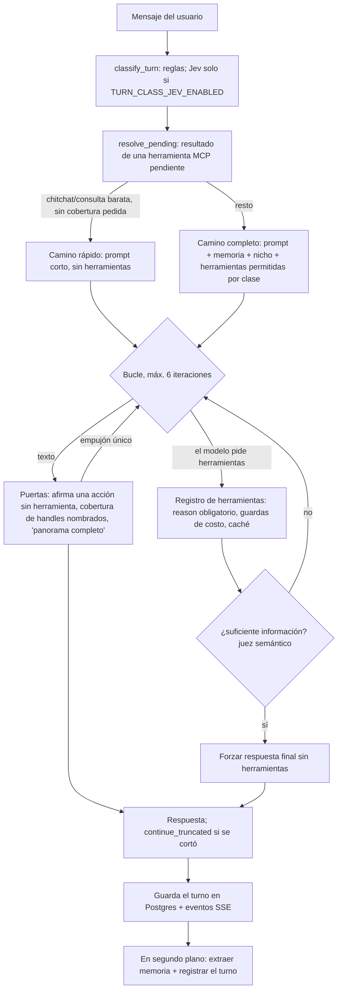

# Cómo funciona la IA de Lumi

Paquete Python puro `lumi/lumi_ai/` (no importa Django; lo comprueba `lumi_ai/tests/test_boundaries.py`) más el pegamento Django en
`lumi/apps/intelligence/`. Todo colaborador entra por un puerto (`lumi_ai/ports.py`, `PORTS_VERSION` 1.12); PostgreSQL vía ORM es el único
almacén transaccional. Los valores de umbrales y modelos salen de `AIConfig` (`lumi_ai/config.py`), que se llena con `AIConfig.from_env()`.

## 1. Un turno del agente (`agent/loop.py`)

- **Clasificación**: las reglas deciden sin llamar a ningún modelo; si ninguna aplica y `TURN_CLASS_JEV_ENABLED` está encendido, Jev puntúa 4 preguntas.
  Un fallo del clasificador solo puede **ampliar** el acceso (clase `other`: camino completo), nunca recortarlo.
- **Herramientas por clase**: `allowed_for(clase)` limita por `cost` (`free`, `credits`, `llm`, `write`). Las herramientas MCP (gateway de CONNECT) solo se descubren si la clase permite todos los costos.
- **Presupuesto de contexto**: `max_request_tokens=6700` (el muro de Groq está en ≈ 7000 tokens por petición). `fit_messages` recorta historial viejo antes de cada llamada; si todos los proveedores contestan 413, el bucle recorta y reintenta (`RequestTooLarge`).
- **Honestidad**: si el modelo dice que hizo algo sin haber corrido herramientas, se le empuja una vez; si aun así insiste, se añade un aviso. Los handles nombrados que no se escanearon bloquean la frase "panorama completo".
- **Errores al usuario**: el evento SSE `error` no incluye `str(exc)`; el detalle va solo al log.

## 2. Proveedores y cadena (`providers/`)

Orden: **OpenLux** (opcional, no acepta modelo fijado) → **Groq** (`openai/gpt-oss-120b`, luego `qwen/qwen3.8-27b`, que es *Preview*) → **OpenRouter**
(`meta-llama/llama-3.3-70b-instruct`, de pago). Solo entran los proveedores que tienen key; sin ninguna key la cadena está vacía y las llamadas lanzan `NoProviderConfigured`.

- Un candidato que contesta 401/402/403/429 descansa `PROVIDER_COOLDOWN_SECONDS` (300 s; con `Retry-After`, tope 900 s) para no pagar una llamada fallida por turno. Si todos descansan, se prueban igual (el más cercano a expirar primero).
- Un `model=` o `tier=` explícito fija **un** candidato por proveedor: una petición "small" nunca sube de nivel en silencio.
- `effort` va como `reasoning_effort`; un 400 reintenta el mismo candidato una vez sin él.
- Todas las llamadas (éxitos y fallos) van a un `UsageSink` (tabla de uso en Postgres).
- Los modelos se cambian con `GROQ_MODEL_LARGE`, `GROQ_MODEL_SMALL`, `GROQ_MODEL_FALLBACK`, `OPENROUTER_MODEL`, `OPENLUX_MODEL`, `WHISPER_MODEL` (probado en `tests/test_config.py`).
- Transcripción: Groq `whisper-large-v3-turbo` (`providers/audio.py`).

## 3. RAG (`rag/`)

PostgreSQL guarda todo texto; **Chroma solo guarda vectores y metadatos de filtro** (`profile_id`, `platform`, `kind`, `niche_key`). No existe ningún argumento `documents=` (se comprueba con `rg -n "documents=" lumi/lumi_ai/rag`).

| Colección | Id del vector | Contenido |
|---|---|---|
| `voice_corpus` | `post:<posts.id>` | Posts propios auténticos del usuario (ejemplos de voz) |
| `peer_posts` | `peer_post:<posts.id>` | Posts de competidores vistos por el análisis |
| `agent_memory` | `memory:<memory_notes.id>` | Notas de memoria del agente |

- Embedder local sin key: `onnx-minilm-l6-v2` (384 dim, 79 MB que se descargan una vez a `~/.cache/chroma`). Es mejor en inglés; en español funciona, pero separa menos. Si cambia el embedder, Chroma lo detecta (`VectorIndexMismatch`) y hay que reindexar.
- Chroma Cloud si hay `CHROMA_API_KEY` (+ `CHROMA_TENANT`, `CHROMA_DATABASE`); si no, un cliente local persistente en `CHROMA_PATH` (`.chroma`; falta añadirlo a `.gitignore`, que es de ARCHITECT).
- Recuperación (`retrieval.py`): consulta los ids en Chroma y pide el texto a Postgres. Las memorias más lejanas que `memory_max_distance` (0.85, **sin calibrar**) no se ofrecen; `MemoryService.decay` borra las notas sin uso en `memory_decay_days` (90) y sus vectores.
- **Reindexar**: `uv run python manage.py reindex_vectors [--collection voice_corpus|peer_posts|agent_memory] [--profile ID] [--no-reset]`.
  Por defecto reinicia cada colección (borra vectores de filas ya eliminadas y los de un embedder anterior) y re-embebe todas las filas de todos los perfiles; `--profile` implica `--no-reset`. Postgres manda: siempre se puede borrar Chroma y reconstruirlo con los mismos ids (`apps/intelligence/tests/test_reindex.py`).

## 4. Pipeline de competidores (`competitors/pipeline.py`)

1. **Traer** posts de las cuentas (hasta `peer_max_accounts=8`) mediante el puerto `SocialData` (Xpoz, de CONNECT) y la línea base de cada cuenta (mediana propia de 4 semanas).
2. **Ganadores** elegidos por código (`winners.py`), nunca por el modelo ni con un umbral fijo; nunca se baja el umbral para llenar un cupo.
3. **Video** (solo con `VIDEO_PROVIDER`): un video por post a etiquetar, ganadores primero, tope `video_max_per_run=5` análisis nuevos; ver §7.
4. **Etiquetado ciego** (`extract.py`): el modelo ve solo texto (sin métricas ni URL) en lotes de 6 y hasta `peer_max_posts_to_tag=80` posts; un fallo se guarda como etiquetado `failed`.
5. **Lift** por atributo (`lift.py`) y **síntesis** de frameworks con evidencia que apunta a posts guardados (`synthesize.py`).
6. **Fotos de autor** (`competitors/handles.py`, puerto `HandleBook`): el escaneo guarda en `social_handles` las cuentas leídas y cada autor visto, sin llamadas de pago. Gana la foto ya guardada; la que trae la fuente solo rellena un handle sin foto. Por eso `viral_posts[].avatar_url` prefiere la guardada y usa la de la fuente solo si no hay ninguna, y la respuesta coincide con la base. Si la tabla cae, el escaneo sigue igual.
7. **Guardar**: los posts de pares se guardan *antes* que el informe porque `framework_evidence` los referencia. Un informe sin sustento se guarda como `insufficient_data` o `failed`, sin frameworks y con un `detail` honesto; no hay payload enlatado. LinkedIn y Facebook (sin lectura de terceros) se informan como tales.

## 5. Generación (`generation/flow.py`)

Contexto (ejemplos propios similares `generation_examples=3`, frameworks ganadores `generation_frameworks=2`, reglas de la plataforma) → **dificultad** (Jev; si no responde, una regla) decide el nivel del primer intento (`easy`→small, `standard`/`hard`→large) → **redactor** → **revisor** (reglas duras + evaluación) → hasta `generation_max_regenerations=2` reintentos guiados con el motivo → **guardar una sola vez** la solicitud y todos sus intentos en una transacción. Si no sale un borrador utilizable lanza `GenerationFailed` y no guarda nada (no quedan solicitudes huérfanas).
Las reglas por plataforma (x, linkedin, facebook, tiktok, instagram: límites, hashtags) están en `generation/platforms.py`.

## 6. Evaluación (`evaluation/`)

`checks.py` (reglas duras, deterministas) → similitud de estilo con el perfil de voz → rúbrica puntuada por jueces en orden (**Jev**, luego el LLM pequeño) → `gate.py` decide `pass` / `regenerate` / `fail`:

- `regenerate` si algún criterio < `quality_min_criterion` (0.5) o la media < `quality_pass_mean` (0.7);
- `fail` si la media o "sin hechos inventados" < `quality_fail_below` (0.3);
- `quality_min_style_similarity=0.0`: la similitud se registra pero no decide, porque el coseno crudo no tiene escala calibrada.
- Si ningún juez responde, la evaluación lo dice (`judge="rules"`) y solo valen las reglas; no se inventan puntajes. Un borrador que ya rompe una regla dura ni siquiera se manda a un juez.
- `uv run python manage.py ai_eval --suite golden` repite puntajes grabados de **casos sintéticos** (sin keys, sin costo); `--live` usa los jueces reales y **gasta cuota**, no se corre por defecto. La calibración con posts reales que el usuario aceptó está pendiente.

## 7. Video (`video/`) — apagado por defecto

Con `VIDEO_PROVIDER=gemini` y `VIDEO_API_KEY`, los videos de competidores se analizan con Gemini y el resultado entra al etiquetado ciego como un campo extra. Se descargan con protección SSRF (solo http(s), solo IPs públicas, tope `VIDEO_MAX_MB=20`) y se cachean por (media, proveedor, versión del prompt) en `video_analysis_records`. Comparación y propuesta: [`VIDEO_API_COMPARISON.md`](VIDEO_API_COMPARISON.md). Con `VIDEO_PROVIDER` vacío el pipeline es idéntico a antes y la herramienta `analyze_video` no existe.

## 8. Qué cuesta cada cosa

| Pieza | Quién cobra | Notas |
|---|---|---|
| Turno de chat / generación / etiquetado | Groq (plan de la key) → OpenRouter (de pago; con saldo vacío da 402 y descansa 5 min) | Cada 6 posts etiquetados = 1 llamada LLM. Hay topes por corrida (`peer_*`, `generation_*`). Precios no verificados hoy |
| Embeddings | Nada (ONNX local) | Descarga única de 79 MB |
| Chroma | Local gratis; Cloud según plan | |
| Jev (juez, dificultad, clasificador) | TypeSafe, cuota de la key | Fallo ⇒ cae a reglas / LLM pequeño |
| Transcripción | Groq Whisper turbo ≈ $0.04/h (mín. 10 s) | Fuente: https://console.groq.com/docs/speech-to-text (2026-10-27) |
| Datos de redes (Xpoz) | Créditos de CONNECT; el pipeline tiene tope por plataforma | Una corrida que exceda el presupuesto lo dice, no falla en silencio |
| Video | Gemini de pago ≈ $0.008–0.013 por video de 60 s con `gemini-3.5-flash-lite` | Solo con key; tope 5 nuevos por corrida; ver VIDEO_API_COMPARISON.md |
| Trazas | Neatlogs (si hay key) | |

## 9. Qué se apaga sin cada key

| Falta | Efecto |
|---|---|
| Todas las keys de LLM (Groq, OpenRouter, OpenLux) | No hay chat ni generación (`NoProviderConfigured`); RAG, importadores y lecturas siguen |
| `GROQ_API_KEY` | La cadena sigue con OpenLux/OpenRouter; no hay transcripción |
| `OPENROUTER_API_KEY` | Sin último respaldo; si Groq falla, el turno falla |
| `TYPESAFE_API_KEY` | Jev no responde: dificultad por regla, clasificador solo por reglas, jueces de calidad vía LLM pequeño |
| `CHROMA_API_KEY` | Chroma local en `CHROMA_PATH` (funciona, no es compartido entre servidores) |
| `NEATLOGS_API_KEY` | Sin trazas; las llamadas no cambian |
| `OPENLUX_API_KEY` | Solo se salta ese proveedor (opcional) |
| `VIDEO_PROVIDER` / `VIDEO_API_KEY` | Sin análisis de video; el resto idéntico |
| Xpoz (de CONNECT) | Sin datos de competidores: el pipeline informa que no puede leerlos |

`uv run python manage.py check_keys --only groq,openrouter,typesafe,neatlogs,chroma,openlux,video` prueba cada key sin gastar (listados o llamadas gratuitas; el probe de Groq/OpenRouter hace una finalización mínima); nunca imprime una key.

## 10. Dónde mirar

| Tema | Archivo |
|---|---|
| Bucle y puertas | `lumi_ai/agent/loop.py`, `agent/gates.py`, `agent/turn_class.py` |
| Cadena de proveedores | `lumi_ai/providers/chain.py`, `providers/factory.py` |
| Registro de herramientas | `lumi_ai/tools/registry.py` |
| RAG | `lumi_ai/rag/`, `apps/intelligence/reindex.py` |
| Competidores | `lumi_ai/competitors/` |
| Generación y evaluación | `lumi_ai/generation/`, `lumi_ai/evaluation/` |
| Video | `lumi_ai/video/` |
| Persistencia Django | `apps/intelligence/repos/`, `models.py`, `wiring.py` |
| Pruebas | `lumi_ai/tests/`, `apps/intelligence/tests/`; las de keys reales llevan `@pytest.mark.live` y exigen `LUMI_RUN_LIVE=1` |

## Timeout de herramientas de escritura

El bucle ejecuta cada herramienta con `asyncio.wait_for`. Cancelar la corrutina no detiene un hilo del ORM
que ya está escribiendo, así que antes la fila podía guardarse *después* de decirle al modelo que la
herramienta falló. Ahora (`lumi_ai/cancel.py`, `apps/intelligence/repos/aio.py`):

- Las herramientas que escriben (`ToolSpec.writes`: coste `write` o efectos `writes_db`/`writes_index`)
  reciben un `CancelToken` en un `ContextVar`. Las de solo lectura no, y se ejecutan igual que antes.
- `@aio` ejecuta cada escritura dentro de `transaction.atomic()` y, justo antes del commit, pasa por
  `token.commit_gate()`: si el token está cancelado lanza `WriteCancelled` y la transacción se revierte.
- Al vencer el timeout el bucle activa la bandera y espera un commit que ya esté en curso (el candado cubre el
  commit). Si algún commit llegó a ocurrir, el modelo recibe «ya se guardaron N escrituras, comprueba el estado»
  en vez del mensaje de timeout normal.

Límites: una herramienta con varias escrituras conserva las anteriores al timeout; las llamadas externas
(Meta, MCP) y los vectores de Chroma no se pueden revertir (Chroma se reconstruye con `reindex_vectors`).
Cualquier escritura de otro módulo (p. ej. CONNECT) que quiera la misma garantía debe pasar por `@aio`.
