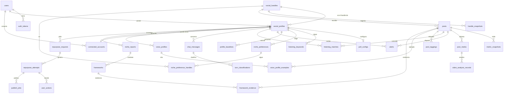

# Esquema de base de datos (PostgreSQL)

Estado: **propuesta v2 para revisión** de LUMI-INTELLIGENCE y LUMI-CONNECT. Autor: LUMI-ARCHITECT. Rama `lumi-orquestador`. Este archivo no cambia sin avisar en `plan/estado/ARCHITECT.md`. La API y las firmas de servicio están en `CONTRATOS.md`.

El texto de los documentos va en español. Los nombres de tablas, columnas, modelos y funciones van en inglés.

Cambios de v1 a v2 (respuesta a la revisión de INTELLIGENCE en `estado/INTELLIGENCE.md`):

| N.º | Tema | Decisión |
| --- | --- | --- |
| 1 | `Platform` | Igual que `lumi_ai.ports.Platform` (`PORTS_VERSION` 1.3): `x`, `linkedin`, `facebook`, `instagram`, `tiktok`. Se quitan `youtube` y `reddit`. Añadir una plataforma es una migración de `profiles` que pide quien la necesite. |
| 2 | `generation_evaluations.attempt_id` | Clave foránea obligatoria. El servicio de generación crea el intento y la evaluación en una transacción. INTELLIGENCE pasa `EvaluationRecord.attempt_id` como obligatorio en los puertos 1.3. Desviación declarada (`CONTRATOS.md` 11, fila 16): hoy el intento y la evaluación se guardan en dos transacciones. |
| 3 | Palabras clave de escucha | Tabla `listening_keywords` (una fila por palabra y perfil). Se quita la columna `keywords` que v1.1 proponía en `poll_configs`. |
| 4 | `user_search_requests` y la plataforma | La plataforma sale de `social_handles` (la FK ya la fija). Regla de servicio: si quien llama no da plataforma, se usa la del perfil. |
| 5 | `niche_preferences` | Columnas `niche_key`, `title`, `source`, `is_active`, y tablas hijas `niche_preference_keywords` y `niche_preference_handles` (FK a `social_handles`). Un solo nicho activo por perfil. |
| 6 | `frameworks` | Se añade `payload` jsonb (salida cruda del modelo). No se añade `title`: `name` es el título. |
| 7 | `turn_classifications` | Se añaden `message_preview` y `path_taken`. Las columnas `jev_*` conservan su nombre porque el importador las copia 1:1. |
| 8 | `repurpose_attempts.is_fallback` | Ya estaba en v1 (booleano obligatorio, defecto `false`). INTELLIGENCE añade `is_fallback` a `AttemptIn` en los puertos 1.3. |
| 9 | `posts.language` | Nueva columna (`PostIn.language`). |
| 10 | Tipos de post | `apps.profiles.services` usa los de `lumi_ai.ports` (`PostIn`, `PostOut`, `PostMetrics`, `MediaRef`, `PeerPostIn`, `BaselineOut`). |

## 1. Objetivo y alcance

El esquema sustituye las 21 tablas SQLModel/Alembic del backend FastAPI. Sirve el flujo de la demo: el usuario conecta una red social, Lumi trae contenido autorizado de su nicho, la IA analiza posts y videos, aprende patrones y genera un post personalizado que el usuario revisa en React.

Reglas del proyecto que el esquema cumple:

- PostgreSQL es la única base (desarrollo, tests y producción). No hay camino SQLite.
- Hay varios usuarios desde el principio. Todo dato pertenece a un `User` directa o indirectamente.
- ChromaDB guarda solo vectores. Postgres guarda todo el texto (sección 9).
- No se guarda ningún valor de key en la base. Los tokens OAuth de terceros van cifrados con Fernet (`TOKEN_ENCRYPTION_KEY`).

## 2. Convenciones comunes

| Tema | Regla |
| --- | --- |
| Nombres | `db_table` explícito en `snake_case` plural. Modelos en `PascalCase` singular. |
| Clave primaria | `bigint` identidad (`BigAutoField`). Excepción: `background_jobs.id` es `uuid`. La API expone los ids como números (el frontend actual ya usa enteros). |
| Tiempo | Todo `timestamptz` (`USE_TZ=True`). La API entrega ISO 8601 en UTC. Nunca se guarda ni se compara un datetime sin zona. |
| `created_at`, `updated_at` | Los pone `apps.core.models.TimestampedModel` en las tablas que se modifican. Las tablas solo de inserción (snapshots, baselines, mensajes) llevan su propia marca de evento en lugar de `updated_at`. |
| Defectos | `db_default` (defecto del lado del servidor), por ejemplo `db_default=Now()`. Así un `INSERT` SQL directo, del importador o a mano, no deja columnas sin valor. |
| Enums | `TextChoices` en minúsculas más `CheckConstraint` con nombre. El legado guarda algunos en mayúsculas (`USER`, `ASSISTANT`); el importador los baja a minúsculas. |
| Métricas ausentes | Una métrica que no llegó es `NULL`, nunca `0`. Los `CHECK` aceptan `NULL` o valor mayor o igual a 0. |
| Fechas desconocidas | `posts.published_at` es `NULL` cuando la fuente no la dio. No se inventa ni se rellena con la fecha de ingesta. |
| JSONB | Solo para salida cruda validada de un modelo o de una API (por ejemplo `analysis`, `report`, `evaluation`), argumentos de herramientas y registros de ejecución. Todo dato que se filtra, une o agrega es columna. |
| Texto libre acotado | `varchar(n)` con `n` que sale del dominio (handle 100, plataforma 20). El texto largo es `text`. |
| Borrado | Ver sección 3. |
| Índices | Un índice por cada acceso nombrado en `CONTRATOS.md`. Los índices de ordenación usan el orden real (`-created_at`). Los parciales llevan `condition=`. |
| Restricciones con nombre | `uq_<tabla>_<campos>`, `ck_<tabla>_<regla>`, `ix_<tabla>_<campos>`. Las apps ajenas siguen el mismo patrón. Un índice no puede pasar de 30 caracteres (`models.E034`): se abrevia el nombre, no la regla. |
| Django 5.2 | `CheckConstraint(condition=...)` (el argumento `check=` está obsoleto). `UniqueConstraint(condition=...)` para únicos parciales. |

### Plataformas, fuentes y estados compartidos

`apps/core/choices.py` define enums que usan varias apps. Cambiarlos exige una migración de `profiles`, así que los pide el equipo que los necesite a ARCHITECT (cambio de una línea, `0002_*`).

| Enum | Valores |
| --- | --- |
| `Platform` | `x`, `linkedin`, `facebook`, `instagram`, `tiktok` (los mismos que `lumi_ai.ports.Platform`) |
| `IngestSource` | `pfm`, `xpoz`, `meta`, `linkedin`, `x`, `import`, `manual` |
| `PostKind` | `original`, `reply`, `retweet`, `quote` |
| `JobStatus` | `queued`, `running`, `succeeded`, `failed`, `cancelled` |

## 3. Política de borrado (`on_delete`)

| Relación | Política | Motivo |
| --- | --- | --- |
| `User` a sus datos (perfiles, conexiones, tokens, jobs) | `CASCADE` | Borrar un usuario borra sus datos. Es la acción de "eliminar mi cuenta". |
| `SocialProfile` a sus hijos (baselines, poll, alerts, matches, chat, voz, reportes, solicitudes) | `CASCADE` | Un perfil sin dueño no tiene uso. |
| `SocialHandle` a `Post`, `HandleSnapshot` | `CASCADE` | Un handle es una identidad pública compartida. |
| `SocialProfile.handle` a `SocialHandle` | `PROTECT` | No se borra un handle que un perfil usa. |
| `Post` a `MetricSnapshot`, `PostMedia`, `PostTagging` | `CASCADE` | Son datos del post. |
| `Post` desde `Alert`, `ListeningMatch` | `CASCADE` | Un alert sin post no se puede mostrar. |
| `Post` desde `VoiceProfileExample` | `CASCADE` | El ejemplo desaparece con el post. |
| `Post` desde `RepurposeRequest.source_post` | `SET_NULL` | La solicitud y su resultado se conservan. |
| `ChatMessage` desde `TurnClassification.message` | `SET_NULL` | El análisis de enrutamiento sobrevive al borrado del historial. |

Los posts de otros usuarios (competidores) son compartidos: dos perfiles que siguen el mismo handle comparten filas de `social_handles`, `posts` y `metric_snapshots`. Borrar un perfil no borra esos datos compartidos. Un barrido (`manage.py prune_orphans`, parte de T9) borra los handles sin referencias tras 30 días.

## 4. Mapa de apps y dueños

| App | Dueño de migración | Tablas |
| --- | --- | --- |
| `accounts` | ARCHITECT | `users`, `auth_tokens` (más las tablas M2M de grupos y permisos que genera Django) |
| `core` | ARCHITECT | `background_jobs`, `legacy_import_map` |
| `profiles` | ARCHITECT | `social_handles`, `handle_snapshots`, `social_profiles`, `profile_baselines`, `poll_configs`, `listening_keywords`, `posts`, `post_media`, `metric_snapshots`, `alerts`, `listening_matches` |
| `chat` | ARCHITECT | `chat_messages` |
| `intelligence` | INTELLIGENCE (columnas finales); ARCHITECT fija nombres, FK y únicos | `voice_profiles`, `voice_profile_examples`, `style_answers`, `niche_preferences`, `niche_preference_keywords`, `niche_preference_handles`, `post_taggings`, `niche_reports`, `niche_report_peers`, `frameworks`, `framework_evidence`, `repurpose_requests`, `repurpose_attempts`, `generation_evaluations`, `user_actions`, `turn_classifications`, `user_search_requests`, `memory_notes`, `profile_memory_summaries`, `video_analysis_records` |
| `connections` | CONNECT (columnas finales); ARCHITECT fija nombres, FK y únicos | `connected_accounts`, `oauth_states`, `publish_jobs`, `mcp_auth_accounts`, `mcp_pending_writes`, `handle_search_cache`, `handle_search_cache_entries`, `xpoz_credit_ledger` |

Los nombres de modelo de INTELLIGENCE y CONNECT son los de sus planes (`RepurposeRequest`, `UserAction`, `PublishJob`, `VideoAnalysisRecord`, `GenerationEvaluation`, `NichePreference`). No se renombran.

## 5. Relaciones

Cadena de la demo: `connected_accounts` (cuenta enlazada) a `social_profiles` a `posts` propios y de pares, a `post_media`, a `video_analysis_records`, a `post_taggings`, a `niche_reports` y `frameworks`, a `voice_profiles`, a `repurpose_requests` y `repurpose_attempts` (el borrador que el usuario revisa), a `user_actions` (aceptar, editar, rechazar) y a `publish_jobs` (publicación confirmada por el usuario).

## 6. Tablas de ARCHITECT

Notación: `PK` clave primaria, `FK` clave foránea, `NN` no nulo. "Defecto" es el `db_default` salvo que se diga otra cosa.

### 6.1 `accounts`

**`users`** (`accounts.User`, `AUTH_USER_MODEL`, login por email)

| Columna | Tipo | Reglas |
| --- | --- | --- |
| `id` | bigint PK | |
| `email` | varchar(254) NN | Único (`unique=True`, que Django exige en `USERNAME_FIELD`) y siempre en minúsculas: `CheckConstraint(email = lower(email), name="ck_users_email_lowercase")`. El servicio guarda el email en minúsculas. |
| `password` | varchar(128) NN | Hash de Django. Contraseña inutilizable (`!`) en el usuario "importado". |
| `display_name` | varchar(120) NN | Defecto `''`. |
| `is_active`, `is_staff`, `is_superuser` | boolean NN | Defectos `true`, `false`, `false`. |
| `last_login` | timestamptz | Nulo. |
| `created_at`, `updated_at` | timestamptz NN | `TimestampedModel`. |

**`auth_tokens`** (`accounts.AuthToken`)

| Columna | Tipo | Reglas |
| --- | --- | --- |
| `id` | bigint PK | |
| `user_id` | FK `users` NN | `CASCADE`. Índice. |
| `key_hash` | char(64) NN | SHA-256 hexadecimal de la clave. Único (`uq_auth_tokens_key_hash`). La clave en claro se muestra una sola vez, en la respuesta de `register` y `login`. |
| `name` | varchar(80) NN | Defecto `''`. Etiqueta del dispositivo. |
| `created_at` | timestamptz NN | |
| `last_used_at` | timestamptz | Nulo. Se actualiza como máximo una vez por minuto. |
| `expires_at` | timestamptz NN | Defecto de aplicación: 30 días (`AUTH_TOKEN_TTL_DAYS`). |

Desviación del plan, que propone `rest_framework.authtoken`: la tabla de DRF guarda la clave en claro, tiene un token por usuario y no caduca. Esta tabla permite cerrar sesión por dispositivo, caducar y no dejar claves en la base. El contrato HTTP es el mismo (`Authorization: Token <clave>`), así que el frontend y los otros bots no se enteran. Está en las preguntas abiertas (sección 12).

### 6.2 `core`

**`background_jobs`** (`core.BackgroundJob`). Estado visible al cliente de trabajos que corren en Celery.

| Columna | Tipo | Reglas |
| --- | --- | --- |
| `id` | uuid PK | `uuid4`. |
| `user_id` | FK `users` NN | `CASCADE`. |
| `profile_id` | FK `social_profiles` | Nulo. `CASCADE`. |
| `kind` | varchar(60) NN | Nombre con punto, en minúsculas. Valores reservados: `profile.refresh`, `profile.bootstrap`, `niche.analyze`, `content.generate`, `trends.scan`. Los nuevos se añaden a la lista de `CONTRATOS.md`. |
| `status` | varchar(12) NN | `JobStatus`, defecto `queued`. `ck_background_jobs_status`. |
| `progress` | smallint | Nulo o entre 0 y 100 (`ck_background_jobs_progress`). |
| `params` | jsonb NN | Defecto `{}`. Nunca contiene secretos. |
| `result` | jsonb | Nulo. Resumen pequeño; los datos grandes van a sus tablas. |
| `error_code`, `error_message` | varchar(60), text NN | Defecto `''`. El mensaje no incluye trazas ni valores de keys. |
| `dedupe_key` | varchar(160) | Nulo. Evita dos ejecuciones activas iguales. |
| `celery_task_id` | varchar(155) NN | Defecto `''`. |
| `created_at`, `started_at`, `finished_at` | timestamptz | `created_at` NN. |

Índices: (`user`, `-created_at`); (`profile`, `kind`, `-created_at`); parcial (`status`) donde `status in ('queued','running')`. Único parcial `uq_background_jobs_active_dedupe` sobre `dedupe_key` donde `dedupe_key is not null and status in ('queued','running')`.

**`legacy_import_map`** (`core.LegacyImportMap`). Lo escribe el importador de T8. Hace el importador repetible y garantiza cero pérdida verificable: ninguna fila legada se descarta sin dejar su contenido aquí. `--verify` cuenta las filas fusionadas y omitidas como contabilizadas solo si tienen `payload`. El `payload` va cifrado porque puede traer `pfm_account_id` o tokens.

| Columna | Tipo | Reglas |
| --- | --- | --- |
| `id` | bigint PK | |
| `source_table` | varchar(80) NN | Tabla legada. |
| `source_pk` | varchar(120) NN | Clave legada como texto. |
| `target_table` | varchar(80) NN | Tabla nueva. |
| `target_pk` | bigint NN | Clave nueva. `0` en las omitidas. |
| `outcome` | varchar(10) NN | `imported`, `merged` o `skipped`. `ck_legacy_import_map_outcome`. |
| `payload` | text (cifrado) | La fila legada completa en JSON, cifrada con Fernet (`EncryptedTextField`). Obligatoria si `outcome` no es `imported` (`ck_legacy_import_map_payload`). En `imported` solo si el importador cambió algún valor. |
| `imported_at` | timestamptz NN | |

Único (`source_table`, `source_pk`, `target_table`). Se puede borrar en T12.

### 6.3 `profiles`

**`social_handles`** (`profiles.SocialHandle`). Identidad pública en una plataforma, compartida entre usuarios. Sustituye a la colección Chroma `handle_mappings` y al texto repetido de handles en cinco tablas legadas.

| Columna | Tipo | Reglas |
| --- | --- | --- |
| `id` | bigint PK | |
| `platform` | varchar(20) NN | `Platform`. `ck_social_handles_platform`. |
| `handle_normalized` | varchar(100) NN | Minúsculas, sin `@`. `ck_social_handles_normalized`: `handle_normalized = lower(handle_normalized)` y coincide con `^[a-z0-9._-]{1,100}$`. La regla fina por plataforma (X: 15 caracteres) la aplica el servicio. |
| `handle_display` | varchar(100) NN | Defecto `''`. Mayúsculas como las vio la fuente. |
| `display_name` | varchar(200) NN | Defecto `''`. |
| `avatar_url` | text NN | Defecto `''`. |
| `external_id` | varchar(64) NN | Defecto `''`. Id numérico de la plataforma si se conoce. |
| `follower_count` | bigint | Nulo o mayor o igual a 0. Último valor conocido (copia desnormalizada de `handle_snapshots`, se escribe en la misma transacción). |
| `follower_count_at` | timestamptz | Nulo. Fecha de ese valor. |
| `origin` | varchar(12) NN | `profile`, `live`, `cache`, `selected`, `niche`, `import`. Defecto `live`. Equivale al campo `origin` de Chroma. |
| `last_seen_at` | timestamptz NN | Defecto ahora. |
| `created_at`, `updated_at` | timestamptz NN | |

Único `uq_social_handles_platform_handle` (`platform`, `handle_normalized`). Índice de prefijo para `GET /handles/search`: `Index(fields=["platform","handle_normalized"], opclasses=["varchar_pattern_ops","varchar_pattern_ops"], name="ix_social_handles_prefix")`. Índice (`-last_seen_at`).

Regla de escritura heredada de Chroma (`add-if-absent`): una fila existente no cambia su `origin` por una escritura de menor rango (`selected` > `live` > `cache` > `niche`). La implementa `get_or_create_handle`, no la base.

**`handle_snapshots`** (`profiles.HandleSnapshot`). Historial de seguidores de cualquier handle. Sustituye a `profile_snapshots` (que solo servía a handles propios).

| Columna | Tipo | Reglas |
| --- | --- | --- |
| `id` | bigint PK | |
| `handle_id` | FK `social_handles` NN | `CASCADE`. |
| `captured_at` | timestamptz NN | Defecto ahora. |
| `followers`, `following` | bigint | Nulos o mayores o iguales a 0. |
| `source` | varchar(12) | Nulo. `IngestSource`. |

Único (`handle`, `captured_at`). Índice (`handle`, `-captured_at`).

**`social_profiles`** (`profiles.SocialProfile`). El perfil con el que trabaja un usuario: su cuenta en una red.

| Columna | Tipo | Reglas |
| --- | --- | --- |
| `id` | bigint PK | |
| `user_id` | FK `users` NN | `CASCADE`. |
| `handle_id` | FK `social_handles` NN | `PROTECT`. |
| `timezone` | varchar(64) | Nulo. Nombre IANA. |
| `timezone_source` | varchar(16) | Nulo. `inferred` o `user_confirmed`. `ck_social_profiles_timezone`: `timezone_source` es nulo si y solo si `timezone` es nulo. |
| `bootstrapped_at` | timestamptz | Nulo. Marca cuándo terminó el primer análisis (`mark_bootstrapped`). Hace idempotente `bootstrap_profile`. |
| `created_at`, `updated_at` | timestamptz NN | |

Único `uq_social_profiles_user_handle` (`user`, `handle`). Esto corrige "sin único en `profiles.handle`" y el perfil único `profile_id=1` con handle `AtehOfficial`: no hay ningún handle ni id fijo en el código, y toda consulta se filtra por `user`.

La plataforma y el handle viven en `social_handles`. La identidad externa de la cuenta enlazada (`provider`, `external_account_id`, antes `pfm_account_id`) vive solo en `connections.ConnectedAccount`, que apunta a este perfil. El plan proponía repetir esos campos en `SocialProfile`; se evita para no guardar el mismo dato en dos tablas.

**`profile_baselines`** (`profiles.ProfileBaseline`). Solo inserción; vale la fila más reciente.

| Columna | Tipo | Reglas |
| --- | --- | --- |
| `id` | bigint PK | |
| `profile_id` | FK `social_profiles` NN | `CASCADE`. |
| `window_days` | smallint NN | Defecto 90. Mayor que 0. |
| `n_posts` | integer NN | Defecto 0. Mayor o igual a 0. |
| `median_views`, `median_engagement`, `p75_views` | double precision NN | Defecto 0. Mayores o iguales a 0. |
| `baseline_reliable` | boolean NN | Defecto `false`. |
| `computed_at` | timestamptz NN | Defecto ahora. |

Índice (`profile`, `-computed_at`). `latest_baseline` lee la primera fila de ese índice.

**`poll_configs`** (`profiles.PollConfig`)

| Columna | Tipo | Reglas |
| --- | --- | --- |
| `id` | bigint PK | |
| `profile_id` | OneToOne `social_profiles` NN | `CASCADE`. |
| `interval_minutes` | smallint NN | Defecto 5. Entre 1 y 1440 (`ck_poll_configs_interval`). |
| `is_active` | boolean NN | Defecto `false`. |
| `last_polled_at` | timestamptz | Nulo. |
| `created_at`, `updated_at` | timestamptz NN | |

Índice parcial (`last_polled_at`) donde `is_active`. El poller reclama los vencidos con un solo `UPDATE ... SET last_polled_at = now() WHERE is_active AND (last_polled_at IS NULL OR last_polled_at <= now() - interval_minutes * interval '1 minute') RETURNING profile_id`. Dos workers no reclaman el mismo perfil.

**`listening_keywords`** (`profiles.ListeningKeyword`). Palabras que sigue la escucha social de un perfil. Las lee y escribe `ListeningStore` a través de `get_listening` y `set_listening`.

| Columna | Tipo | Reglas |
| --- | --- | --- |
| `id` | bigint PK | |
| `profile_id` | FK `social_profiles` NN | `CASCADE`. |
| `keyword` | varchar(100) NN | Sin espacios en los extremos. No vacía (`ck_listening_keywords_not_blank`). |
| `created_at` | timestamptz NN | Defecto ahora. |

Único `uq_listening_keywords_profile_keyword` (`profile`, `Lower("keyword")`). El orden es el de `id`. `set_listening` reemplaza el conjunto en una transacción (borra las que sobran e inserta las nuevas).

**`posts`** (`profiles.Post`). Tabla única de posts propios y ajenos. Une las tablas legadas `posts` (propios), `user_activity` (replies y retweets propios) y los posts que antes solo vivían en `listening_matches` o en Chroma.

| Columna | Tipo | Reglas |
| --- | --- | --- |
| `id` | bigint PK | |
| `author_id` | FK `social_handles` NN | `CASCADE`. Un post es propio de un perfil si `author_id = perfil.handle_id`. No hay FK a perfil. |
| `platform_post_id` | varchar(64) NN | Id externo. |
| `kind` | varchar(10) NN | `PostKind`. Defecto `original`. |
| `kind_source` | varchar(10) | Nulo (dato legado) o `api` o `heuristic`. |
| `caption` | text NN | Defecto `''`. |
| `url` | text NN | Defecto `''`. |
| `published_at` | timestamptz | Nulo cuando se desconoce. |
| `is_stub` | boolean NN | Defecto `false`. Verdadero si la fila existe solo como ancla (por ejemplo, un `post_taggings` legado cuyo post nunca se ingirió). Un `upsert_posts` posterior lo llena y lo pone en `false`. |
| `source` | varchar(12) | Nulo. `IngestSource`. |
| `conversation_id` | varchar(64) NN | Defecto `''`. |
| `language` | varchar(12) NN | Defecto `''`. Código de idioma si la fuente lo da. |
| `thread_position` | smallint | Nulo o mayor o igual a 1 (base 1, como en el legado). |
| `is_thread_head` | boolean | Nulo significa "no calculado" (dato legado). |
| `text_truncated` | boolean NN | Defecto `false`. |
| `is_deleted_suspect` | boolean NN | Defecto `false`. |
| `last_seen_at` | timestamptz | Nulo. |
| `created_at`, `updated_at` | timestamptz NN | |

Único `uq_posts_author_platform_post` (`author`, `platform_post_id`). La plataforma sale del `author`, por eso no hay columna `platform`. `upsert_posts` usa `INSERT ... ON CONFLICT (author_id, platform_post_id) DO UPDATE`, que es idempotente. `published_at` y las métricas ya conocidas no se sobrescriben con `NULL`.

Índices: (`author`, `-published_at`); parcial (`author`, `-published_at`) donde `kind = 'original' and not is_deleted_suspect` (extracción de voz y analytics); parcial (`conversation_id`) donde `conversation_id <> ''`.

**`post_media`** (`profiles.PostMedia`). Imágenes y videos del post. Es el punto de entrada del análisis de video.

| Columna | Tipo | Reglas |
| --- | --- | --- |
| `id` | bigint PK | |
| `post_id` | FK `posts` NN | `CASCADE`. |
| `position` | smallint NN | Defecto 0. |
| `kind` | varchar(8) | Nulo (tipo desconocido, puertos 1.9) o `image`, `video`, `gif`. Nunca se adivina por la URL. CHECK `ck_post_media_kind` (`profiles.0002`). |
| `url` | text NN | |
| `thumbnail_url` | text NN | Defecto `''`. |
| `duration_seconds` | numeric(8,2) | Nulo o mayor que 0. |
| `width`, `height` | integer | Nulos o mayores que 0. |

Único (`post`, `position`). Índice parcial (`post`) donde `kind = 'video'`. No hay datos legados: `lumi.db` no guarda medios.

**`metric_snapshots`** (`profiles.MetricSnapshot`). Solo inserción.

| Columna | Tipo | Reglas |
| --- | --- | --- |
| `id` | bigint PK | |
| `post_id` | FK `posts` NN | `CASCADE`. |
| `captured_at` | timestamptz NN | Defecto ahora. |
| `source` | varchar(12) | Nulo. `IngestSource`. |
| `likes`, `comments`, `shares`, `views`, `bookmarks`, `quotes` | bigint | Nulos o mayores o iguales a 0 (`ck_metric_snapshots_nonneg`). `shares` es el conteo de retweets o compartidos. |

Único `uq_metric_snapshots_post_captured` (`post`, `captured_at`). Índice (`post`, `-captured_at`). Se elimina `age_hours`: se calcula como `captured_at - posts.published_at`. El `include_object` de Alembic que saltaba el índice descendente en SQLite desaparece.

**`alerts`** (`profiles.Alert`). Un aviso al usuario. Sustituye a `posts.alerted_at`, `posts.alert_dismissed` y a los campos de alerta de `listening_matches`.

| Columna | Tipo | Reglas |
| --- | --- | --- |
| `id` | bigint PK | |
| `profile_id` | FK `social_profiles` NN | `CASCADE`. |
| `post_id` | FK `posts` NN | `CASCADE`. |
| `kind` | varchar(12) NN | `spike` (post propio por encima de su baseline), `niche_match` (post de un par). |
| `trigger` | varchar(16) | Nulo. `velocity`, `jev_backstop`, `scan`. Nulo en datos legados. |
| `status` | varchar(10) NN | `active` o `dismissed`. Defecto `active`. |
| `velocity` | double precision | Nulo. Likes por hora al disparar. |
| `baseline_velocity` | double precision | Nulo. Velocidad base del perfil en ese momento. |
| `created_at` | timestamptz NN | Defecto ahora. |
| `dismissed_at` | timestamptz | Nulo. `ck_alerts_dismissed`: no nulo solo si `status = 'dismissed'` (los datos legados descartados pueden traerlo nulo; ver la regla de importación). |

Único parcial `uq_alerts_one_active` (`profile`, `post`, `kind`) donde `status = 'active'`. Índice parcial (`profile`, `-created_at`) donde `status = 'active'`, que sirve la bandeja de no leídas.

Semántica: "avisar una vez por episodio". El legado avisa una vez y vuelve a avisar si el usuario descarta el aviso y el post sigue subiendo. El único parcial reproduce eso: puede haber muchas filas `dismissed` y como máximo una `active`. `create_alert_once` hace `INSERT ... ON CONFLICT DO NOTHING RETURNING id` (SQL crudo, porque `bulk_create(ignore_conflicts=True)` no dice si insertó) y devuelve `True` solo si insertó. Es atómico entre procesos, sin lectura previa. El plan propone `UniqueConstraint(profile, post, kind)` sin condición; con ese único un aviso descartado no se puede repetir. Está en las preguntas abiertas.

**`listening_matches`** (`profiles.ListeningMatch`). Tabla puente "este perfil encontró este post de un par".

| Columna | Tipo | Reglas |
| --- | --- | --- |
| `id` | bigint PK | |
| `profile_id` | FK `social_profiles` NN | `CASCADE`. |
| `post_id` | FK `posts` NN | `CASCADE`. |
| `discovered_at` | timestamptz NN | Defecto ahora. |
| `score` | double precision | Nulo. |

Único (`profile`, `post`). Índice (`profile`, `-discovered_at`). El caption, el autor, la URL y las métricas ya no se copian: se leen de `posts` y `metric_snapshots`.

### 6.4 `chat`

**`chat_messages`** (`chat.ChatMessage`). Un hilo por perfil, como hoy.

| Columna | Tipo | Reglas |
| --- | --- | --- |
| `id` | bigint PK | El orden por `id` es el orden de la conversación. |
| `profile_id` | FK `social_profiles` NN | `CASCADE`. |
| `role` | varchar(10) NN | `user`, `assistant`, `tool`. `ck_chat_messages_role`. |
| `content` | text NN | Defecto `''`. |
| `tool_name` | varchar(80) | Nulo. Solo en filas `tool`. |
| `tool_call_id` | varchar(80) | Nulo. Id de la llamada, solo en filas `tool`. |
| `tool_calls` | jsonb | Nulo. Solo en filas `assistant` que piden herramientas. Forma: `[{"id": str, "name": str, "arguments": object}]`. |
| `tools_used` | text[] | Nulo. Resumen de nombres de herramientas del turno; va en la fila final de respuesta. |
| `reason` | text | Nulo. Argumento `reason` de la llamada, en filas `tool`. |
| `created_at` | timestamptz NN | Defecto ahora. |

Índice (`profile`, `id`). Borrar el historial es `DELETE ... WHERE profile_id = %s`, una sola consulta. El plan sugería evaluar una tabla hija por herramienta; no hay ninguna consulta por herramienta en el legado ni en los planes, así que `tool_calls` queda como JSONB con la forma documentada. `tool_call_id` es nuevo: permite reconstruir los mensajes `tool` que exigen los proveedores de modelos.

El título del chat no se guarda (`POST /chat/title` no tiene estado).

## 7. Tablas de INTELLIGENCE (app `intelligence`)

INTELLIGENCE implementa estos modelos y puede añadir columnas. Lo que no puede cambiar sin pasar por ARCHITECT: el nombre de tabla, las claves foráneas con su `on_delete`, los únicos, los `CHECK` y las columnas marcadas "importador". Si discrepa, lo anota en `estado/INTELLIGENCE.md` y avisa al orquestador antes de divergir.

Todas dependen de `profiles.0001_initial` (y `chat.0001_initial` en `turn_classifications`).

| Tabla (modelo) | Columnas | Restricciones fijas |
| --- | --- | --- |
| `voice_profiles` (`VoiceProfile`) | `id`, `profile_id` FK `CASCADE`, `platform` varchar(20) NN defecto `general` (`Platform` o `general`; sustituye al "nulo = general" del plan para que el único funcione sin `NULLS NOT DISTINCT`), `version` integer NN, `is_current` boolean NN defecto `false`, `source` varchar(10) NN (`posts` o `questions`), `payload` jsonb NN, `model` varchar(100) NN defecto `''`, `prompt_version` varchar(40) NN defecto `''`, `created_at` | Único (`profile`, `platform`, `version`). Único parcial (`profile`, `platform`) donde `is_current`. Cambiar la voz actual es una transacción con `select_for_update` sobre la fila vigente. |
| `voice_profile_examples` (`VoiceProfileExample`) | `id`, `voice_profile_id` FK `CASCADE`, `post_id` FK `posts` `CASCADE`, `position` smallint NN | Único (`voice_profile`, `post`). Sustituye a `voice_profiles.example_post_ids` (JSON sin FK). |
| `style_answers` (`StyleAnswer`) | `id`, `profile_id` FK `CASCADE`, `question_key` varchar(80) NN, `answer` text NN, `created_at`, `updated_at` | Único (`profile`, `question_key`); se escribe con upsert. Lectores actuales: ninguno. Desde este diseño lo lee `answer_style_questions` (arranque en frío). |
| `niche_preferences` (`NichePreference`) | `id`, `profile_id` FK `CASCADE`, `niche_key` varchar(120) NN (forma `<slug>:<geo_scope>`), `title` varchar(200) NN, `source` varchar(10) NN (`user`, `inferred`), `is_active` boolean NN defecto `true`, `created_at`, `updated_at` | Único (`profile`, `niche_key`). Único parcial (`profile`) donde `is_active`: un solo nicho activo por perfil. Tabla nueva, sin datos legados. |
| `niche_preference_keywords` (`NichePreferenceKeyword`) | `id`, `preference_id` FK `CASCADE`, `keyword` varchar(100) NN | Único (`preference`, `Lower("keyword")`). |
| `niche_preference_handles` (`NichePreferenceHandle`) | `id`, `preference_id` FK `CASCADE`, `handle_id` FK `social_handles` `CASCADE` | Único (`preference`, `handle`). Sustituye a `tracked_handles` por plataforma; la plataforma sale del handle. |
| `post_taggings` (`PostTagging`) | `id`, `post_id` FK `posts` `CASCADE`, `prompt_version` varchar(40) NN defecto `''`, `status` varchar(10) NN defecto `pending` (`pending`, `ok`, `failed`), `analysis` jsonb nulo, `framework_guess` varchar(120) NN defecto `''`, `validation_error` text NN defecto `''`, `tagged_at` timestamptz nulo, `created_at` | Único (`post`, `prompt_version`). Une `own_post_analysis` y `post_taggings`, que tenían la misma forma. |
| `niche_reports` (`NicheReport`) | `id`, `profile_id` FK `CASCADE`, `query` text NN, `niche` varchar(200) NN, `status` varchar(18) NN (`pending`, `ok`, `insufficient_data`, `failed`), `posts_analyzed` integer NN, `winner_count` integer NN, `peers_analyzed` integer NN, `report` jsonb NN (salida cruda validada), `origin` varchar(24) NN (`pipeline`, `legacy_peer_frameworks`, `legacy_niche_report`), `created_at` | Índice (`profile`, `-created_at`). Une `peer_frameworks` y `niche_framework_reports`. |
| `niche_report_peers` (`NicheReportPeer`) | `id`, `report_id` FK `CASCADE`, `handle_id` FK `social_handles` `CASCADE` | Único (`report`, `handle`). El legado solo guarda el conteo, así que los datos legados no la llenan. |
| `frameworks` (`Framework`) | `id`, `report_id` FK `CASCADE`, `name` varchar(160) NN, `description` text NN, `lift` double precision nulo, `confidence` double precision nulo (entre 0 y 1), `payload` jsonb nulo (salida cruda del modelo para este framework), `ordinal` smallint NN | Único (`report`, `ordinal`). |
| `framework_evidence` (`FrameworkEvidence`) | `id`, `framework_id` FK `CASCADE`, `post_id` FK `posts` `CASCADE` | Único (`framework`, `post`). La evidencia deja de ser texto dentro del JSON. |
| `repurpose_requests` (`RepurposeRequest`) | `id`, `profile_id` FK `CASCADE`, `source_caption` text NN, `source_post_id` FK `posts` `SET_NULL` nulo, `route_label` varchar(10) nulo (`easy`, `standard`, `hard`), `created_at`; INTELLIGENCE añade `mode` y `brief` para la generación desde un tema | `ck_repurpose_requests_route`. Índice (`profile`, `-created_at`). |
| `repurpose_attempts` (`RepurposeAttempt`) | `id`, `request_id` FK `CASCADE`, `platform` varchar(20) NN, `tier` varchar(10) nulo, `model` varchar(100) nulo, `provider` varchar(20) nulo, `attempt_no` smallint NN, `output` text NN, `must_keep_passed` boolean NN, `judge_verdict` varchar(3) nulo (`yes`, `no`), `judge_confidence` double precision nulo, `is_fallback` boolean NN defecto `false` (nuevo: hoy se pierde), `created_at` | Único (`request`, `platform`, `attempt_no`). Este es el borrador que el usuario revisa en React. |
| `generation_evaluations` (`GenerationEvaluation`) | `id`, `attempt_id` FK `CASCADE`, `style_score` double precision nulo, `decision` varchar(10) NN (`pass`, `regenerate`, `fail`), `evaluation` jsonb NN, `created_at` | `attempt_id` obligatorio (decisión 2). Índice (`attempt`). Tabla nueva. |
| `user_actions` (`UserAction`) | `id`, `attempt_id` FK `CASCADE`, `action` varchar(6) NN (`accept`, `edit`, `reject`), `edited_text` text nulo, `created_at` | `ck_user_actions_edited`: `edited_text` no es nulo solo si `action = 'edit'`. |
| `turn_classifications` (`TurnClassification`) | Las columnas legadas: `profile_id` FK `CASCADE`, `message_id` FK `chat_messages` `SET_NULL`, `created_at`, `message_text_hash`, `message_preview` text NN defecto `''` (primeros 160 caracteres), `path_taken` varchar(4) nulo (`fast`, `full`), `rule_class`, `rule_matched`, `jev_called`, `jev_class`, `jev_probs` jsonb, `jev_confidence`, `jev_latency_ms`, `jev_error`, `final_class`, `tools_called` text[], `total_latency_ms`, `user_corrected`, `timings` jsonb | Índices (`profile`, `-created_at`) y (`message`). |
| `user_search_requests` (`UserSearchRequest`) | `id`, `profile_id` FK `CASCADE`, `handle_id` FK `social_handles` `CASCADE`, `request_note` text NN defecto `''`, `created_at` | Índice (`profile`, `-created_at`). La plataforma es la de `handle`. Si la tool no la recibe, el servicio usa la plataforma principal del perfil (`get_or_create_handle(platform, handle)`). |
| `memory_notes` (`MemoryNote`) | `id`, `profile_id` FK `CASCADE`, `kind` varchar(20) NN, `content` text NN, `content_hash` char(64) NN, `created_at`, `last_accessed_at`, `access_count` integer NN | Único (`profile`, `content_hash`). El decaimiento semanal borra por `last_accessed_at`. Id de Chroma: `memory:{id}`. Sustituye a las colecciones con texto. |
| `profile_memory_summaries` (`ProfileMemorySummary`) | `id`, `profile_id` OneToOne `CASCADE`, `summary_md` text NN, `updated_at` | Sustituye a `memory.md`. |
| `video_analysis_records` (`VideoAnalysisRecord`) | `id`, `media_id` FK `post_media` `CASCADE`, `provider` varchar(30) NN, `model` varchar(100) NN, `prompt_version` varchar(40) NN, `status` varchar(10) NN, `result` jsonb nulo, `error` text NN defecto `''`, `created_at` | Único (`media`, `provider`, `prompt_version`): sirve de caché por medio y versión. |

Las tablas `niche_preferences` (con sus hijas), `generation_evaluations`, `video_analysis_records`, `niche_report_peers` y `listening_keywords` no tienen origen legado.

## 8. Tablas de CONNECT (app `connections`)

CONNECT implementa estos modelos. Fijos: nombres de tabla, FK, únicos, y que todo token y verificador PKCE se guarda cifrado con Fernet (`apps.core.fields.EncryptedTextField`, publicado). Dependen de `accounts.0001_initial` (por `AUTH_USER_MODEL`), `profiles.0001_initial` y, desde `0003`, `intelligence.0001_initial` (la FK `attempt`).

| Tabla (modelo) | Columnas fijas | Restricciones fijas |
| --- | --- | --- |
| `connected_accounts` (`ConnectedAccount`) | `user_id` FK `CASCADE`, `social_profile_id` FK `social_profiles` nulo `SET_NULL`, `provider` (`pfm`, `meta`, `linkedin`, `x`, `google`; CHECK `ck_connected_accounts_provider`, `google` desde `0005`), `external_account_id` (texto plano: es un identificador, no una credencial), `platform` varchar(20) (red de la cuenta; hace falta en `pfm`, donde un proveedor cubre varias redes; migración `0002`), `display_name` varchar(200) y `handle` varchar(100) (ambos en `0002`; vacíos por defecto), `status` (`active`, `expired`, `revoked`, `limited`, `error`), `scopes` text[], `access_token` y `refresh_token` cifrados, `expires_at`, `last_refreshed_at`, `last_error` | Único (`provider`, `external_account_id`). Único parcial (`social_profile`, `provider`) donde `social_profile` no es nulo. `CHECK` sobre `provider` (`ck_connected_accounts_provider`) y sobre `status` (`ck_connected_accounts_status`). Índices `ix_connected_accounts_user` (`user`, `provider`) e `ix_connected_accounts_expiry` (`expires_at`). Reemplaza a `profiles.pfm_account_id`. |
| `oauth_states` (`OAuthState`) | `state` varchar(128), `user_id` FK `CASCADE`, `provider`, `social_profile_id` FK `social_profiles` nulo `SET_NULL` (perfil al que se enlaza la cuenta cuando el callback tiene éxito; `0002`), `code_verifier` cifrado, `redirect_after`, `created_at`, `expires_at`, `consumed_at` nulo | `state` único. Índice `ix_oauth_states_expiry` sobre `expires_at`. `provider` no lleva `CHECK`: el callback valida el proveedor antes de crear la fila. El consumo es un `UPDATE ... SET consumed_at = now() WHERE state = %s AND consumed_at IS NULL AND expires_at > now() RETURNING ...`: un solo uso, atómico. |
| `publish_jobs` (`PublishJob`) | `profile_id` FK `CASCADE`, `connected_account_id` FK `SET_NULL` nulo, `attempt_id` FK `repurpose_attempts` `SET_NULL` nulo, `platform`, `text`, `status` (`pending`, `done`, `failed`, `unknown`; `unknown` = no se sabe si el proveedor publicó), `fingerprint` varchar(64) (hash del contenido, para detectar un reintento duplicado), `external_post_id`, `external_url` text (enlace público de la publicación; vacío por defecto), `error`, `idempotency_key`, `dry_run`, `created_at`, `updated_at` | `CHECK` sobre `status` (`ck_publish_jobs_status`), sobre `platform` (`ck_publish_jobs_platform`) y sobre `fingerprint` con la expresión regular `^[0-9a-f]{64}$` (`ck_publish_jobs_fingerprint`: 64 caracteres hexadecimales en minúscula, más estricto que solo la longitud). Índice `ix_publish_jobs_recent` (`profile`, `created_at` descendente). Único (`profile`, `idempotency_key`). El plan de CONNECT dice "único"; se acota al perfil para que un usuario no pueda chocar con la clave de otro. |
| `mcp_auth_accounts` (`McpAuthAccount`) | `user_id` FK `CASCADE`, `account` varchar(40), tokens cifrados, `token_type`, `scopes` text[], `expires_at`, `updated_at` | Único (`user`, `account`). El legado era un único global por `account`. |
| `handle_search_cache`, `handle_search_cache_entries` | Caché de búsquedas de handles: consulta normalizada, `platform`, `fetched_at`, y filas hijas que apuntan a `social_handles` con `rank` smallint (posición en el resultado, 0 por defecto; las filas se leen por `rank`, `id`) | `CHECK` sobre `platform` (`ck_handle_cache_platform`). Único (`platform`, `query_normalized`) y único (`cache`, `handle`). Índice de prefijo `ix_handle_cache_prefix` (`platform`, `query_normalized`, con `varchar_pattern_ops`) para buscar por inicio de texto. Sustituye a la colección Chroma de caché con texto. |
| `mcp_pending_writes` (`McpPendingWrite`, `0004`) | `user_id` FK `CASCADE`, `social_profile_id` FK `social_profiles` `CASCADE` (uno a uno), `tool` varchar(200), `server_tool` varchar(200), `arguments` jsonb (por defecto `{}`), `summary` text (vacío por defecto), `created_at`, `expires_at` | Único (`social_profile`): una escritura pendiente por perfil, y una petición nueva reemplaza a la anterior. Se reclama con un `DELETE` atómico. Índice `ix_mcp_pending_expiry` sobre `expires_at`. Es la escritura que el modelo pidió y el usuario aún no confirmó; vive aquí y no en memoria para sobrevivir a varios workers y reinicios. |
| `xpoz_credit_ledger` (`XpozCreditLedger`) | Una fila por llamada de pago a Xpoz. CONNECT eligió tabla. `user_id` FK `CASCADE` nulo (una llamada del sistema no tiene usuario), `provider` varchar(12) (`xpoz` por defecto), `route` varchar(60), `credits` entero positivo, `key_slot` (1 o 2; la clave se identifica por posición, nunca por valor), `run_id` varchar(64) vacío por defecto, `created_at` | `CHECK` `key_slot` en (1, 2) (`ck_xpoz_ledger_slot`). Índice `ix_xpoz_ledger_recent` (`created_at` descendente). |

## 9. Reglas de ChromaDB

Postgres es la fuente de verdad del texto. Chroma guarda solo vectores y metadatos mínimos.

| Regla | Detalle |
| --- | --- |
| Id de vector | `{tipo}:{id de Postgres}`: `post:123`, `memory:45`, `handle:78`, `voice_example:9`. Una consulta devuelve ids y se resuelve el texto con `WHERE id IN (...)` en Postgres. |
| Metadatos permitidos | `object_type`, `object_id`, `profile_id`, `platform`, `embedding_model`, `content_hash`. Nada de captions, handles ni nombres. |
| Documentos | Ninguna llamada a Chroma pasa `documents=`. Los embeddings se calculan en el cliente a partir del texto de Postgres en el momento de vectorizar y se pasan como `embeddings=`. |
| Idempotencia | `upsert` por id. `content_hash` evita recalcular lo que no cambió. No hay tabla propia de seguimiento de vectores (pregunta abierta 6). |
| Reconstrucción | `manage.py reindex_vectors` (INTELLIGENCE) borra y recrea las colecciones desde Postgres. Un test de ida y vuelta lo comprueba. |
| Borrado | Al borrar una fila de Postgres, el código que la borra llama al borrado de su vector con el mismo id. Si falla, `reindex_vectors --prune` limpia los ids huérfanos. |

Las colecciones actuales (`handle_mappings`, caché de handles, posts de pares, memoria, bullets de perfil) guardan texto que no existe en `lumi.db`. No se migran; se vuelven a crear (sección 13).

## 10. Mapa legado a nuevo

El importador usa este mapa (`MIGRACION_LEGADA.md` lo detalla en T8). En todas las tablas, `id` legado se conserva como `id` nuevo cuando la tabla nueva es de correspondencia 1:1 y queda registrado en `legacy_import_map`. Excepción aceptada por el orquestador: los ids solo se conservan en `social_profiles`, `posts` y `chat_messages`; el resto recibe ids nuevos y el mapa guarda la relación. Los enums legados en mayúsculas pasan a minúsculas.

**Usuario.** Si el origen no trae usuarios, el importador crea el usuario `importado` (email `importado@lumi.invalid`, contraseña inutilizable) y le asigna todos los perfiles y las cuentas MCP.

### 10.1 `profiles` a `social_handles`, `social_profiles`, `connected_accounts`

| Legado | Nuevo | Transformación |
| --- | --- | --- |
| `profiles.id` | `social_profiles.id` | Se conserva. |
| `profiles.platform` | `social_handles.platform` | Minúsculas. Valor fuera de `Platform`: la fila se omite y se informa. |
| `profiles.handle` | `social_handles.handle_normalized`, `handle_display` | Sin `@`, minúsculas; el original va a `handle_display`. Dos perfiles con el mismo handle normalizado se fusionan en el de menor `id`; los hijos del otro se reasignan y la fusión se informa. |
| `profiles.name` | `social_handles.display_name` | Solo si estaba vacío. |
| `profiles.pfm_account_id` | `connected_accounts.external_account_id` con `provider = 'pfm'` | Los ids que empiezan por `demo-` no crean cuenta enlazada (son datos de seed). La fila nueva se crea con `status = 'active'` y tokens vacíos hasta que CONNECT los refresque. El id se guarda en texto plano (CONTRATOS 11, fila 20). |
| `profiles.created_at` | `social_profiles.created_at` | Se asume UTC si es naive. |
| `profiles.timezone`, `timezone_source` | igual | Sin cambios. |
| (nuevo) | `social_profiles.user_id`, `bootstrapped_at` | Usuario importado; `bootstrapped_at` queda nulo. |

### 10.2 Perfiles, posts y métricas

| Legado | Nuevo | Transformación |
| --- | --- | --- |
| `profile_snapshots` (`profile_id`, `captured_at`, `followers`, `following`, `source`) | `handle_snapshots` | `profile_id` pasa a `handle_id` del handle del perfil. Único (`handle`, `captured_at`): ante duplicados se conserva el de `id` mayor y se informa. |
| `profile_baseline` (todas las columnas) | `profile_baselines` | Igual, una fila por fila. |
| `posts.id` | `posts.id` | Se conserva (la voz y las etiquetas lo referencian). |
| `posts.profile_id` | `posts.author_id` | Handle del perfil. |
| `posts.platform_post_id`, `caption`, `published_at`, `source`, `last_seen_at`, `is_deleted_suspect`, `text_truncated`, `conversation_id`, `thread_position`, `is_thread_head`, `kind_source` | mismas columnas | `conversation_id` nulo pasa a `''`. |
| `posts.kind` (nulo) | `posts.kind` | Nulo pasa a `original` (así lo trataba el código). |
| `posts.alerted_at`, `alert_dismissed` | `alerts` | Si `alerted_at` no es nulo: una fila `kind = 'spike'`, `trigger` nulo, `created_at = alerted_at`, `status = 'dismissed'` si `alert_dismissed` y `'active'` si no. `dismissed_at` queda nulo en las descartadas (la hora real no se guardaba). |
| `metric_snapshots.post_id`, `captured_at`, `likes`, `comments`, `shares`, `views`, `source` | `metric_snapshots` | `post_id` por el mapa de `posts`. |
| `metric_snapshots.age_hours` | (se elimina) | Derivable de `captured_at - published_at`. La verificación no la incluye en la suma. |
| `user_activity` (`profile_id`, `platform_post_id`, `kind`, `caption`, `published_at`, `likes`, `replies`, `views`, `source`, `created_at`) | `posts` (`kind = 'reply'` o `'retweet'`) y `metric_snapshots` | Una fila de `posts` con `author` = handle del perfil. Si algún `likes`, `replies` o `views` no es nulo, se crea una `metric_snapshot` con `captured_at = created_at` y `comments = replies`. Si el `platform_post_id` ya existe en `posts`, gana la fila de `posts` y se informa. |
| `listening_matches` (`profile_id`, `platform_post_id`, `author_handle`, `caption`, `platform_url`, `metrics`, `discovered_at`, `alerted_at`, `alert_dismissed`) | `social_handles`, `posts`, `metric_snapshots`, `listening_matches`, `alerts` | Handle de `author_handle` (se crea si falta). Post con `caption` y `url = platform_url`, `published_at` nulo. `metrics` (JSON con `likes`, `replies` o `comments`, `retweets` o `shares`, `views` o `impressions`) pasa a una `metric_snapshot` en `discovered_at`. Alerta como en `posts`, con `kind = 'niche_match'`. |
| `poll_config` | `poll_configs` | Igual, una fila por fila. |
| `user_search_requests` (`handle`, `request_note`) | `user_search_requests` | `handle` pasa a `handle_id`. |

### 10.3 Chat

| Legado | Nuevo | Transformación |
| --- | --- | --- |
| `chat_messages.id`, `profile_id`, `content`, `tool_name`, `reason`, `created_at` | `chat_messages` | `id` se conserva (el orden depende de él). |
| `chat_messages.role` | `role` | `USER`, `ASSISTANT`, `TOOL` a minúsculas. |
| `chat_messages.tool_calls` | `tool_calls` | JSON tal cual. |
| `chat_messages.tools_used` | `tools_used` | Lista JSON a `text[]`. |
| (nuevo) | `tool_call_id` | Nulo en datos legados. |
| `turn_classifications` | `turn_classifications` | `message_id` por el mapa de `chat_messages`. `tools_called` JSON a `text[]`. `jev_probs` y `timings` siguen en JSONB. |

### 10.4 Inteligencia

| Legado | Nuevo | Transformación |
| --- | --- | --- |
| `voice_profiles` (`profile_id`, `version`, `is_current`, `payload`, `created_at`) | `voice_profiles` | `platform` = plataforma del perfil, `source = 'posts'`. Si hay más de una fila `is_current` por perfil (no debería), queda la de mayor `version`. |
| `voice_profiles.example_post_ids` (JSON) | `voice_profile_examples` | Una fila por id que exista en `posts`; los ids huérfanos se descartan y se informan. `position` es el índice en la lista. |
| `style_answers` | `style_answers` | Único (`profile`, `question_key`): se conserva la fila de mayor `id` y se informan las descartadas. `updated_at = created_at`. |
| `own_post_analysis` (`post_id`, `prompt_version`, `analysis`, `status`, `created_at`) | `post_taggings` | `post_id` por el mapa de `posts`. `prompt_version` nulo pasa a `''`. |
| `post_taggings` (`post_id` texto, `handle`, `status`, `analysis`, `framework_guess`, `validation_error`, `prompt_version`, `tagged_at`) | `post_taggings` | Se resuelve el handle, y el post por (`author`, `platform_post_id`); si no existe, se crea con `is_stub = true`. |
| `peer_frameworks` (`query`, `niche_title`, `payload`, `analyzed_peers_count`, `created_at`) | `niche_reports` | `niche = niche_title`, `status = 'ok'`, `peers_analyzed = analyzed_peers_count`, `report = payload`, `origin = 'legacy_peer_frameworks'`. |
| `niche_framework_reports` (`niche`, `status`, `payload`, `posts_analyzed`, `winner_count`, `created_at`) | `niche_reports` | `report = payload`, `origin = 'legacy_niche_report'`. |
| `payload` de los reportes | `frameworks`, `framework_evidence` | Si el JSON tiene la forma del contrato de `schemas/peer.py`, el importador crea las filas hijas. El JSON completo se conserva siempre en `report`, así que no se pierde nada si la forma no coincide. |
| `repurpose_requests` | `repurpose_requests` | Igual; `route_label` a minúsculas. |
| `repurpose_attempts` | `repurpose_attempts` | `is_fallback = false` (el legado no lo guardaba). |
| `user_actions` | `user_actions` | `action` a minúsculas. |

### 10.5 Conexiones

| Legado | Nuevo | Transformación |
| --- | --- | --- |
| `mcp_auth_accounts` (`account`, `access_token`, `refresh_token`, `token_type`, `scopes`, `expires_at`, `updated_at`) | `mcp_auth_accounts` | `user` = usuario importado. Los tokens se cifran con Fernet al importar y no aparecen en ningún log. `scopes` (texto separado por espacios) pasa a `text[]`. |

### 10.6 Cobertura

Las 21 tablas legadas están mapeadas: `profiles`, `profile_snapshots`, `profile_baseline`, `posts`, `metric_snapshots`, `user_activity`, `listening_matches`, `poll_config`, `user_search_requests`, `chat_messages`, `turn_classifications`, `voice_profiles`, `style_answers`, `own_post_analysis`, `post_taggings`, `peer_frameworks`, `niche_framework_reports`, `repurpose_requests`, `repurpose_attempts`, `user_actions`, `mcp_auth_accounts`.

## 11. Defectos del diseño anterior y su corrección

| Defecto | Dónde estaba | Corrección |
| --- | --- | --- |
| Sin único en el handle | `profiles.handle` | Único (`platform`, `handle_normalized`) en `social_handles` y único (`user`, `handle`) en `social_profiles`. |
| Perfil único `profile_id=1` y handle `AtehOfficial` fijos | Código y datos de arranque | Varios usuarios y perfiles. Sin handle ni id fijo en el código. Todo se filtra por `user`. `seed_demo` usa variables `DEMO_*`. |
| Sin único en `style_answers(profile_id, question_key)` | `style_answers` | Único y escritura por upsert. |
| "Avisar una vez" no era atómico | `posts.alerted_at` | Único parcial en `alerts` más `INSERT ... ON CONFLICT DO NOTHING`. |
| Handles como texto repetido | 5 tablas más Chroma | `social_handles` y FK. |
| `post_taggings.post_id` sin FK | `post_taggings` | FK a `posts`; los posts de pares viven en Postgres. |
| Texto y métricas duplicados | `listening_matches` | Tabla puente sin copias. |
| JSON duplicado | `peer_frameworks.payload`, `niche_framework_reports.payload` | Tablas hijas; JSONB solo para la salida cruda. |
| `example_post_ids` JSON sin FK | `voice_profiles` | `voice_profile_examples`. |
| Una voz actual por perfil frágil | índice parcial con `sqlite_where` | Único parcial real más `select_for_update`. |
| Sin `server_default` | casi todas las columnas con valor por defecto | `db_default`. |
| Fechas naive | varias | `timestamptz` en todo. |
| Tokens MCP en texto plano | `mcp_auth_accounts` | Cifrado Fernet. |
| Memoria en archivo local | `memory.md` | `memory_notes` y `profile_memory_summaries`. |
| Texto en Chroma | colecciones con `documents` | Chroma solo con vectores. |
| `GET /analytics` con efectos secundarios | ruta | `GET` de solo lectura y `POST refresh` aparte (`CONTRATOS.md`). |
| Estado compartido en memoria | OAuth `state`, escrituras MCP | Postgres o caché Redis. |

## 12. Preguntas abiertas

| N.º | Pregunta | A quién | Propuesta por defecto |
| --- | --- | --- | --- |
| 1 | `alerts`: ¿se vuelve a avisar tras descartar? | Orquestador | Sí (único parcial, sección 6.3). El plan proponía único completo. |
| 2 | ¿Un handle verificado (con cuenta enlazada) debe ser único entre usuarios? | CONNECT | No. Dos usuarios pueden tener el mismo handle como perfil; la cuenta enlazada ya es única por (`provider`, `external_account_id`). |
| 3 | Token propio con hash frente a `rest_framework.authtoken` | Orquestador | Token propio. Cambio contenido en `accounts`. |
| 4 | ¿Velocidad de alerta guardada o recalculada? | INTELLIGENCE | Guardada (`velocity`, `baseline_velocity`) para poder explicar el aviso después. |
| 5 | Chat de un solo hilo por perfil o varias conversaciones | Orquestador y frontend | Un hilo, como hoy. Varias conversaciones exigen `chat_threads`. |
| 6 | ¿Hace falta una tabla de seguimiento de vectores? | INTELLIGENCE | No: `upsert` es idempotente y `content_hash` evita recalcular. |
| 7 | `voice_profiles.platform` con `general` en lugar de nulo | INTELLIGENCE | `general` (aceptado por INTELLIGENCE). |
| 8 | `publish_jobs.idempotency_key` único por perfil | CONNECT | Sí. |
| 9 | Importar el texto de Chroma o la `memory.md` si llegan junto al `lumi.db` | Orquestador | No por defecto. Opción `--memory-md PATH` en T8 si el archivo existe. |
| 10 | Tras borrar un usuario, ¿se conservan los posts compartidos de competidores? | Orquestador | Sí; los barre `prune_orphans` tras 30 días sin referencias. |

## 13. Qué no se migra

| Dato | Motivo |
| --- | --- |
| Colecciones de Chroma | No están en `lumi.db`. Se regeneran con `reindex_vectors` a partir de Postgres, salvo el texto de `handle_mappings` (nombres, avatares, seguidores), que se vuelve a obtener al buscar. |
| `memory.md` | Está ignorado por git y no viaja con `lumi.db`. Ver pregunta 9. |
| `metric_snapshots.age_hours` | Derivable. |
| `alembic_version` | Django lleva su propia tabla de migraciones. |
| Campos de alerta de `posts` y `listening_matches` | Se convierten en filas de `alerts`. |

## 14. Normalización

El esquema está en tercera forma normal con estas excepciones deliberadas:

| Excepción | Razón |
| --- | --- |
| `social_handles.follower_count` y `follower_count_at` | Copia del último `handle_snapshots`, que evita un `LATERAL JOIN` en cada búsqueda de handles. Se escribe en la misma transacción que el snapshot. |
| `chat_messages.tools_used` | Resumen del turno que se inyecta en el historial; no se puede derivar de las filas `tool` sin leer todo el turno. |
| `alerts.velocity`, `baseline_velocity` | Valores en el momento del disparo; recalcularlos daría números distintos. |
| JSONB (`payload`, `report`, `analysis`, `evaluation`, `result`, `params`, `tool_calls`, `jev_probs`, `timings`) | Salidas crudas de modelos o APIs, con forma que evoluciona. Ninguna se filtra ni se agrega en SQL. |
