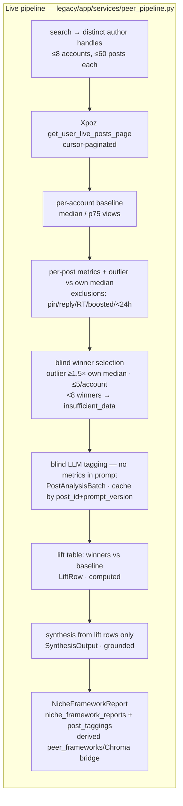
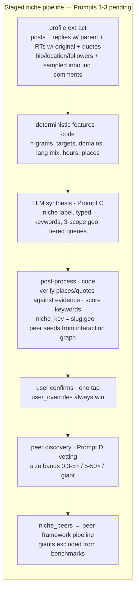
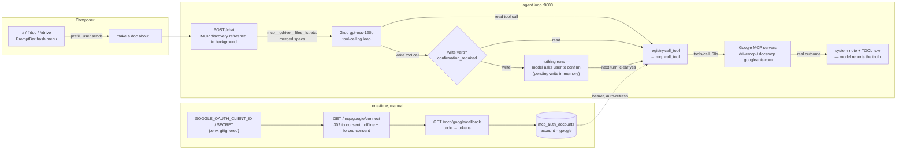
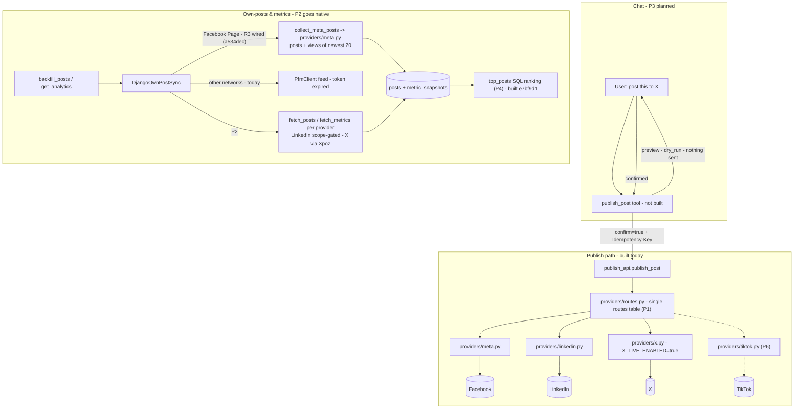

# App Flow Map

End-to-end flow of Lumi, from account connect through agent reply. Keep this in sync when adding tools, routers, or background jobs.

> **HTML version (easier to hand-edit): [`flow-map.html`](flow-map.html)** — same flow, no mermaid export needed.

## Connect → Voice → Peer Frameworks → Chat

```mermaid
flowchart TD
    subgraph Frontend
        UI[React SPA :3010]
        Settings[Settings → Connect X]
        Chat[Chat view]
        Chronic[Chronic Online feed]
        Composer[Webapp composer (external client)<br/>auto AI recaption + hold-to-preview]
    end

    subgraph Backend [FastAPI :8000]
        PFM_CB[GET /pfm/callback]
        ChatRT[POST /chat / /chat/stream]
        RepurposeRT[POST /repurpose<br/>platform fan-out]
        Classify[turn classify: rules → Jev (stage 2, default off)]
        Bootstrap[background/bootstrap.py]
        Poller[background/poller.py]
        MCPRef[background/mcp_refresh.py]

        subgraph Services
            PFM[PFMClient]
            XPOZ[XpozClient]
            Voice[extract_voice_from_captions]
            FW[peer_pipeline<br/>baseline → winners → blind tag → lift → synthesize]
            Analytics[get_profile_analytics]
            Repurpose[repurpose_flow core<br/>classify → generate → enforce → retry]
            Enforce[enforce + Jev judge]
        end

        subgraph DB
            Profiles[(profiles)]
            Posts[(posts + metric_snapshots)]
            Activity[(user_activity)]
            OwnAn[(own_post_analysis +<br/>profile_snapshots + profile_baseline)]
            VoiceProf[(voice_profiles)]
            Matches[(listening_matches)]
            PeerFW[(peer_frameworks)]
            ChatMsg[(chat_messages)]
            TurnCls[(turn_classifications)]
            RepurposeRows[(repurpose_requests + repurpose_attempts)]
        end
    end

    subgraph Chroma [Chroma Cloud / local .chroma — derived index, no-op if down]
        Corpus[(voice_corpus)]
        ChromaMore[(voice_profiles / peer_frameworks / peer_posts / agent_memory)]
    end

    subgraph LLM
        Lux[OpenLux qwen3.8-27b]
        Groq[Groq gpt-oss-120b → qwen3.8-27b]
        OR[OpenRouter llama]
    end

    %% Connect
    Settings -->|POST /pfm/connect| PFM
    PFM -->|auth-url| UserX[X OAuth]
    UserX -->|redirect| PFM_CB
    PFM_CB -->|upsert| Profiles
    PFM_CB -->|schedule| Bootstrap

    %% Voice profile auto-bootstrap
    Bootstrap -->|0. sync_profile_corpus| Corpus
    Bootstrap -->|extract_voice_profile| PFM
    PFM -->|get_account_feed: classify| Posts
    PFM -->|replies + retweets| Activity
    Posts -->|upsert captions| Corpus
    Corpus -->|diverse temporal sample, fallback posts[:10]| Voice
    Activity -->|reply samples → reply_style only| Voice
    VoiceProf -.->|prior version continuity| Voice
    Bootstrap -->|LLM analyze captions| Voice
    Voice -->|save versioned row| VoiceProf
    Bootstrap -->|retry every ~5 min if thin| Bootstrap
    Bootstrap -->|3. _ensure_own_analysis: baseline + lift + pending tags| OwnAn
    Posts -->|final metrics (nearest 72h)| OwnAn

    %% Peer winners → frameworks (baseline-relative pipeline, live 2026-10-26)
    Bootstrap -->|check_niche_trends| XPOZ
    XPOZ -->|viral posts| Matches
    Bootstrap -->|discover handles + fetch ~60 posts/account| XPOZ
    Tools -->|discover_and_extract_niche_frameworks: search → handles| XPOZ
    XPOZ -->|posts for baseline + outlier scores| FW
    FW -->|report JSON| PeerRep[(niche_framework_reports<br/>+ post_taggings)]
    FW -->|report-derived bridge payload| PeerFW

    %% Chat
    Chat -->|SSE| ChatRT
    ChatRT -->|1. classify turn: fast or full path| Classify
    Classify -.->|fire-and-forget row after the reply| TurnCls
    ChatRT -->|2. fit to 6.7k est. tok, then system prompt + profile context| Lux
    Lux -->|model/provider chain| Groq
    Groq -->|both models exhausted| OR
    ChatRT -->|tool calls| Tools
    MCPRef -.->|TTL 300s discovery; the turn only reads the cache| Tools
    Tools --> Analytics
    Analytics -->|classify: original → posts, else| Activity
    Tools --> Repurpose
    Repurpose --> Enforce
    Tools -->|get_analytics result| ChatRT
    ChatRT -->|tool_executions + summary| Chat
    ChatRT -->|persist| ChatMsg

    %% AI recaption (webapp composer → POST /repurpose)
    Composer -->|POST /repurpose (debounced, abortable)| RepurposeRT
    RepurposeRT -->|one read: profile + current voice| VoiceProf
    RepurposeRT -->|asyncio.gather: one core run per platform| Repurpose
    RepurposeRT -->|single batched commit of successes| RepurposeRows
    RepurposeRT -->|per-platform captions → drafts| Composer

    %% Deeper conversation context
    Tools -->|get_user_activity: replies = own words, RTs = shared| Activity

    %% Memory (Phase 3)
    ChatRT -->|after successful turn, fire-and-forget| Extract[extract_turn_memories]
    Extract -->|LLM merges prior summary| MemFile[(memory.md rolling summary)]
    Extract -->|durable facts| ChromaMem[(agent_memory)]
    MemFile -->|summary injected into system prompt| ChatRT

    %% Peer advice retrieval-first
    Tools -->|get_peer_advice: query first| ChromaFW[(peer_frameworks + peer_posts)]
    ChromaFW -.->|found: False → live scan| Tools

    %% Background poller
    Poller -->|backfill + spike check| PFM
    Poller -->|bootstrap pass| Bootstrap
    Poller -->|weekly decay pass| ChromaMem
```

## AI recaption for the webapp composer (added 2026-10-25)

External client flow (the `webappv2` composer; frontend work lives in that repo). **0 Xpoz credits** — Groq + Jev/TypeSafe only, no auth (same demo posture as every route here).

1. The composer auto-runs recaption when its text (≥10 chars) or selected targets change: 1.5 s debounce → `AbortController` cancels any in-flight run → toast **"AI recaption in progress"** → `POST /repurpose` to the lumi backend (`VITE_LUMI_URL`). A content-hash skip means identical text never re-burns LLM calls.
2. `legacy/app/routers/repurpose.py` resolves profile + current voice profile in **one read session**, then fans the platforms out through `legacy/app/services/repurpose_flow.py` (`asyncio.gather`, DB-free — sessions are never held across LLM calls), then persists all successes in **one batched commit**. Per-platform failures come back as honest `ok: false, error` entries; `fallback: true` marks a generator passthrough (LLM outage) so clients never present unchanged text as generated.
3. Platform alias map (frontend 8 ids → lumi's 4 rule sets): `twitter/bluesky/farcaster → x`, `facebook → instagram`, `youtube → linkedin`, `linkedin/tiktok/instagram` native; unknown ids are rejected `422`, never silently aliased.
4. On success the composer writes each caption into `usePlatformDrafts` (escaped HTML, `\n` → `<br>`) and toasts **"Hold to preview captions for each social"**; a **green breathing ring** on the selected socials chips signals readiness (clears per chip once that platform's preview is opened).
5. Holding an account chip still opens the existing `PlatformPreviewModal` (PR #68 hold-to-preview); while a run is in flight, held chips show a breathing loading animation. The modal renders a per-platform tags row (`#hashtags` / `@mentions` extracted from that caption) — the cross-platform tagging display.

Both entry points share the same core: the chat's `repurpose_caption` tool persists rows itself (one request + attempts per call, written **after** the pipeline returns — an LLM failure no longer leaves an orphan request), and `POST /repurpose` does the same per platform in one commit. Tests: `legacy/tests/test_repurpose_endpoint.py` (17 — endpoint, aliases, validation, partial failure, fallback flag, core retry loop, tool return-shape lock) plus the restored `cost="llm"` / `side_effects="writes_db"` decorator metadata in `legacy/tests/test_tool_tiers.py`.

## Turn classification, paths & gates (PROMPT 5 — landed 2026-10-25)

Every turn starts in `legacy/app/agent/turn_class.py` (`classify_turn`): **rules first**, and only when no rule matched does the Jev classifier run — stage 2 is **default OFF** (`turn_class_jev_enabled`), thresholds `0.85`/`0.6`, `800 ms` timeout. The result picks both the tool allowlist (`CLASS_ALLOWED`) and the path:

| Class | Path | Tools exposed (`cost`) | `reasoning_effort` |
|---|---|---|---|
| `chitchat`, `history_meta` | **fast** | none (empty toolset) | `low` |
| `memory` | fast | `free` + `remember`/`recall_memory` | `low` |
| `read_cheap` | **full** | `free` only | `low` |
| `live_scan` | full | `free` + `credits` + `llm` | — (provider default) |
| `write` | full | `free` + `write` (`submit_action`, `connect_account`) | — |
| everything else | full | all tiers | — |

- **Fast path** = `cls.path == "fast"` **and** no pending-write resolution **and** the message is not coverage-guarded (`loop.py` fast-path predicate). It sends `_FAST_PROMPT` (no "Operating rules" block), no tool specs, and no MCP work; `path_taken` records what actually ran.
- **Per-tool cost tiers** (Phase C): `free` / `credits` / `llm` / `write`. Only `credits` and `llm` results are TTL-cached (`credits` 900 s, `llm` 600 s; `free`/`write` never cached). Every tool call requires a non-empty `reason`, and `credits`/`write` calls may not pass a tool-name as the reason — the registry strips `reason` from a *copy* of the arguments so the TOOL row and the `tool_start` SSE event keep it while the handler never sees it.
- **Evidence gates** (zero-tool final replies, precedence order): claim gate → coverage nudge → forced `Recon coverage:` block, unless the reply is an honest decline or tools actually ran. A coverage-required turn never takes the fast path.
- **TOOLS USED note** (prompt rule 22): a separate system message built from earlier turns' `tools_used` (written only on the final assistant reply), appended *before* history; `tools_used` is stripped from the history dicts so it never rides the payload.
- **Instrumentation**: `timings` (`classify_ms`, `prompt_ms`, `completion_ms`, `total_ms`, …) lands on a `turn_classifications` row written **fire-and-forget after the reply** (a failed write never breaks a turn); `GET /health` merges p50/p95 of the newest 100 turns (`legacy/app/services/turn_metrics.py`) and **omits the block entirely** when there is nothing to report — missing metrics stay absent, never `0`.

## Tool → data path (agent tools)

| Tool | Reads | Writes |
|---|---|---|
| `connect_account` | PFM `auth-url` | — (callback creates the profile) |
| `backfill_posts` | PFM `get_account_feed` (paginated, ≤50 pages / 100 originals) | `posts` (upsert, kind/kind_source/truncation/suspect bookkeeping), `metric_snapshots` (snapshot policy, NULL-safe), `user_activity` (replies/RTs routed there), `profile_snapshots`, timezone (weak inference) |
| `extract_voice_profile` | `posts` (or PFM backfill), `user_activity` replies (→ `reply_style` only), Chroma `voice_corpus` sample, prior `voice_profiles` | `voice_profiles` (versioned, one current), `voice_corpus` upsert, `user_activity` (via backfill) |
| `get_voice_profile` | `voice_profiles` | — |
| `get_user_activity` | `user_activity` (replies / retweets, newest first) | — |
| `get_posts` | `posts` | — |
| `get_analytics` | `posts`, `metric_snapshots`, PFM feed, Xpoz live | `posts` (+kind/last_seen/truncation/suspect bookkeeping), `metric_snapshots` (incremental refresh ≤20 items, snapshot policy), `user_activity` (replies/RTs routed there), `profile_snapshots` |
| `top_posts` | `posts`, latest non-null selected metric in `metric_snapshots` | — (SQL ranking over stored data only; no provider call or refresh) |
| `check_niche_trends` | Xpoz `get_user_live_posts` (retry once on 5xx/network) | `listening_matches`, handle DB (`handle_mappings`: tracked accounts w/ bounded enrichment + every author seen, `origin: niche`), writes each author's picture onto the match row (`author_avatar_url`, NULL → UI falls back to unavatar), and the API serves it to ChronicOnline. Per-handle failures are named in `failed_handles`; if *every* handle fails the result carries `error` (nothing is invented) |
| `discover_and_extract_niche_frameworks` | Xpoz `search_live_posts` (discovery, retry once on 5xx/network) → `run_peer_pipeline` (per-account `get_user_live_posts_page`, 28-day baseline) | `niche_framework_reports`, `post_taggings` (upsert by post_id+prompt_version), `peer_frameworks`, Chroma `peer_frameworks` + `peer_posts` (report-derived bridge), handle DB (every search-result author, `origin: niche`). On search failure: no pipeline run, no DB/Chroma write — returns an `error` payload the agent relays honestly. An unsupported run writes an honest `insufficient_data`/`failed` report with zero frameworks (no canned fallback) |
| `get_peer_advice` | Chroma `peer_frameworks` + `peer_posts` first; falls back to one live peer-pipeline run | (via fallback) `niche_framework_reports`, `post_taggings`, `peer_frameworks` + Chroma index |
| `remember` | Chroma `agent_memory` (dedupe) | Chroma `agent_memory`, `memory.md` bullet |
| `recall_memory` | Chroma `agent_memory` (semantic, bumps access metadata) | `access_count` / `last_accessed` metadata |
| `check_trending` | `posts` + `metric_snapshots` | `posts.alerted_at` |
| **@-handle bar MVP** (`mvp/handle_search/server.py`, standalone :8010 **+ main-app shim `/handles/*` on :8000** via `legacy/app/routers/handles.py` → same `api_*` functions) | `lumi.db` (read-only, X only) → Chroma `handle_mappings` → Chroma `handle_cache` → Xpoz `users/live` **per selected platform** (whenever that platform has no **fresh** cached answer — db/remembered never gate) | Chroma `handle_cache` (`platform:query` + results), Chroma `handle_mappings` (**every** pulled handle: pfp + name + followers, `platform`, `origin: live\|cache\|selected\|niche`) |
| `repurpose_caption` | `voice_profiles`, source text | `repurpose_requests`, `repurpose_attempts` |
| `submit_action` | — | `user_actions` |
| `dismiss_alert` | `posts` | `posts.alert_dismissed` |
| `answer_style_questions` | — | `style_answers` |
| `save_user_request` | `peer_frameworks` payloads + `listening_matches` authors + `DEFAULT_NICHE_HANDLES` (membership check only) | `user_search_requests` (append-only; **never** the peer stores). 0 credits, no search — searching a saved handle is the separate `check_niche_trends` step |
| `start/stop_listening` | — | `poll_config` |
| **MCP connector tools** (dynamic `mcp__gdrive__*` / `mcp__gdocs__*`, not in the native registry — merged at `list_tool_specs()` time from the discovery cache that `legacy/app/background/mcp_refresh.py` keeps warm (the turn itself never refreshes)) | Google MCP servers over Streamable HTTP (`tools/list` discovery per connector, TTL 300s; `tools/call` per call, 60s timeout) using the auto-refreshed bearer token from `mcp_auth_accounts` | Google's servers (Drive reads, Doc writes **only after explicit user confirmation**); local: `mcp_auth_accounts` (token refresh upsert). Failures return honest `{error}` payloads — never a raised 500 |

## Content routing (authentic originals vs activity)

All routing lives in **`legacy/app/services/ingest.py`** (shared by every own-post ingestion path — `pfm.backfill_profile_posts`, analytics `_ingest_pfm_feed`, analytics `_ingest_xpoz_user_posts`; `services/pfm.py` re-exports for older call sites):

- `classify_post_kind(caption)` — the text-shape fallback: `original` (incl. quote tweets with own commentary) → **`posts`**; `reply` (`@`-opener) → **`user_activity`** (the user's *own words*; feeds `get_user_activity` + voice `reply_style`); `retweet` (`RT`/`RT @`/`RT:` opener) → **`user_activity`** (content the user *shared* — never attributed to them, never voice material).
- `classify_post_item(...)` — the real decision point: uses **API structural flags when the source provides them** (`kind_source="api"`, Xpoz user-live does: `is_retweet`, `reply_to_tweet_id`, reply-parent handle), otherwise falls back to the text heuristics (`kind_source="heuristic"`). **Self-replies (parent author == the user) become `kind="original"` with thread fields → `posts`, not activity** (Step 2); without flags a `@`-opener stays conservatively out of originals. Provenance is persisted as `posts.kind` + `posts.kind_source`.
- `store_raw_item(...)` — one upsert for posts/activity + `MetricSnapshot` per the snapshot policy below, plus pass bookkeeping (`last_seen_at`, truncation flag, deletion-suspect check).

Defense in depth: extraction filters posts again before the min-count check, the Chroma corpus upsert skips non-authentic captions, and `voice_corpus.clear_profile_corpus` rebuilds clean. Quotes are kept because their commentary is the creator's own words.

## Profile-extract data quality (landed — migration `b7d2e5f8a3c1`)

Fixes from `profile_extract_fixes.md` (Steps 1–3), audit in `docs/profile_extract_audit.md`. Schema: 3 new tables (`own_post_analysis`, `profile_snapshots`, `profile_baseline`) + new columns on `posts` (`kind`, `kind_source`, `conversation_id`, `thread_position`, `is_thread_head`, `source`, `last_seen_at`, `is_deleted_suspect`, `text_truncated`), `metric_snapshots` (`age_hours`, `source`, nullable metrics), `profiles` (`timezone`, `timezone_source`).

- **Missing metrics are NULL, never 0.** Migration data fixes: Rule A (`views=0` & other engagement >0 → NULL, 0 rows matched) and Rule B (all-four-zero snapshot >72h after publish → NULL, **24 rows** — profile 16's fabricated zeros). Downgrade coerces NULL→0 (one-way, documented). Display code coerces with `or 0`; nothing fabricates percentages anymore.
- **Snapshot policy** (`legacy/app/analysis/metrics.py`): append on any change; unchanged posts refresh on the 24h/72h/7d/30d milestones, or ≥6h apart while ≤7d old, or on milestone crossings while older — `age_hours` is stored on every row; `final_metrics` = the snapshot nearest 72h (drives lift/analysis).
- **Deletion suspects** (`ingest.is_second_miss`): two consecutive *complete* passes missing a post inside the 30d window, with an order-agnostic bracket guard (the pass must fetch both older and newer items); conservative "no" when the window is unknown. Suspects are flagged on `posts.is_deleted_suspect`, excluded from baselines/lift — never deleted.
- **Truncation** (`ingest.detect_truncation`): ≥270 chars ending in an ellipsis/URL tail → `posts.text_truncated`, sticky (kept flagged, excluded from analysis; no full-text fetch until `docs/xpoz_capabilities.md` exists).
- **Own baseline = peer baseline by construction** (`legacy/app/analysis/metrics.py` + `lift.py` shared): bootstrap step 3 (`_ensure_own_analysis`) computes `profile_baseline` + own-lift rows per profile (append-only per run); tagging writes `own_post_analysis` rows with `status='pending'` until peer Runtime Prompt A merges — no invented analyses.
- **Timezone**: weak inference (mode of posting hour, ≥10 posts, anchored 21:00) on ingest passes; `user_confirmed` always wins; both exposed as `timezone`/`timezone_source` on `GET /profiles`.
- Read-only sanity report: `uv run python legacy/scripts/own_report.py`. Acceptance tests: `legacy/tests/test_profile_extract_fixes.py` (9 areas).

## Peer-framework upgrade (live since 2026-10-26 — Prompts 1–3 complete)

The old path above (absolute impressions ≥1k → `posts[:20]` → one-shot LLM → canned "Milestones & Shipped Tech" fallback) is **replaced**: both `discover_and_extract_niche_frameworks` and bootstrap `_ensure_peer_frameworks` now run `legacy/app/services/peer_pipeline.py`, and `legacy/app/services/frameworks.py` (with its fallback) is deleted. **Schemas** in `legacy/app/schemas/peer.py` (+8 tests); the diagram above has been redrawn to the new flow.



- **Provenance rule**: scraped / computed / llm_inferred — every number is computed in code, the LLM only judges text; `status:"failed"` reports must carry **no fabricated frameworks**.
- **Replaces (landed 2026-10-26)**: winner selection in `discover_and_extract_niche_frameworks` and bootstrap `_ensure_peer_frameworks`; the canned "Milestones & Shipped Tech" fallback and `legacy/app/services/frameworks.py` with it are **deleted**.
- **Persistence (built 2026-10-26, migration `cefd455456a2`)**: `niche_framework_reports` (one JSON `NicheFrameworkReport` per row) + `post_taggings` (unique `(post_id, prompt_version)`, failures retried on the next run) through `legacy/app/services/peer_store.py`; `peer_frameworks`/`peer_posts` Chroma stays a derived, exception-shielded bridge.
- Still blocked externally: Xpoz `fields` verification (`docs/xpoz_capabilities.md`) + the per-run credit estimate.
- Plan source: `opencode_prompts.md` Prompts 1–3 (each gated on review). Full model inventory + open items: AGENTS.md → "Peer-Framework Pipeline Upgrade".

## Niche extraction upgrade (staged — schema landed, pipeline not wired)

Replaces the hardcoded niche query + handle lists (`bootstrap.py:27-30`, `prompts.py:13-14`, `trends.py:32-34`, frontend) with a niche derived from the user's own profile extract. **Schemas landed** in `legacy/app/schemas/niche.py` (+11 tests); everything drawn above still runs hardcoded — this pipeline feeds the peer-framework upgrade above (`NichePeerSet` → baseline/outlier winners).



- **Why the key matters**: shared polling/benchmarks are per `niche_key = topic_slug:geo_scope` — without geo in the key, Nigerian fintech and US fintech share one pool and everyone's benchmark is wrong.
- **Nothing is invented**: the LLM names, code counts/verifies; handles are code-built from the interaction graph; failed/thin-history runs carry **no fabricated niche** — the user is asked instead.
- **Planned (Prompt 1)**: additive columns on `profiles`/`posts`/`metric_snapshots`/`user_activity` + new tables `post_comments`, `profile_niche`, `niche_keywords`, `niche_registry`, `niche_peers`; Xpoz capability report (`docs/xpoz_capabilities.md`) gates the ingestion work — profile lookup / reply parents / comments are unverified Xpoz assumptions today.
- Plan source: `niche_opencode_prompts.md` Prompts 1–3. Model inventory + open items: AGENTS.md → "Niche Extraction Pipeline Upgrade".

## Chroma (agentic storage)

| Collection | Status | Written by | Read by | Purpose |
|---|---|---|---|---|
| `voice_corpus` | live | `extract_voice_profile` (upsert), bootstrap step 0 | `extract_voice_profile` (diverse temporal sample) | Diverse post sampling instead of `posts[:10]` |
| `voice_profiles` | reserved | (reserved) | (reserved) | Semantic search across profile versions |
| `peer_frameworks` | live | `discover_and_extract_niche_frameworks`, bootstrap `_ensure_peer_frameworks`, startup backfill | `get_peer_advice` (retrieval-first) | Serve stored frameworks instantly |
| `peer_posts` | live | same as `peer_frameworks` (the pipeline's winner post texts) | `get_peer_advice` (concrete examples) | Peer-winner posts behind each framework |
| `agent_memory` | live | `remember`, end-of-turn extractor, `recall_memory` (access metadata) | `recall_memory`, weekly decay | Durable facts beyond the prompt window |

- Client: `legacy/app/services/chroma.py` — `CloudClient` when `CHROMA_API_KEY` is set (prod), local `PersistentClient` at `CHROMA_PATH` otherwise. Chroma Cloud caps per-request `Get` at **limit=300** (helpers paginate).
- **Degradation invariant:** every Chroma helper no-ops / returns `None` when unavailable; the DB path (`posts[:10]`, existing rows, live Xpoz fallback) always still works. Chroma is a derived index — Postgres stays the source of truth.
- Sync/refresh cadence:
  - `voice_corpus`: bootstrap runs `sync_profile_corpus` every pass (connect + poller).
  - frameworks: indexed at extraction time; startup backfill re-indexes all `peer_frameworks` rows; bootstrap **re-extracts weekly** (`FRAMEWORK_REFRESH_DAYS = 7`).
  - `agent_memory`: written per turn (extractor) and on `remember`; **weekly decay** sweep in the poller deletes entries untouched for `MEMORY_DECAY_DAYS = 90`.

## Memory (rolling summary + long-term recall)

1. After every successful agent turn, `extract_turn_memories` runs fire-and-forget (`loop.py:_schedule_memory_extraction`): LLM gets prior summary + the turn, returns `memories[]` + merged `summary`.
2. Summary replaces the profile's `## Profile N` section in **`memory.md`** (project root, gitignored); injected into the system prompt as `AGENT MEMORY` each turn (`build_system_prompt(memory_summary=...)`).
3. Individual durable facts go to Chroma `agent_memory` (deduped) and can be added explicitly via the `remember` tool.
4. `recall_memory` semantic-searches on out-of-context references (operating rule 11) and bumps access metadata.
5. Weekly poller decay (`DECAY_INTERVAL_DAYS = 7`) removes memories not accessed/created in 90 days.

## @-handle bar MVP (real-time search, self-expanding handle DB — wired into the main app 2026-10-21; multi-platform selector 2026-10-25)

`mvp/handle_search/` — born as a side project on port 8010 (still runnable on its own). **Since 2026-10-21 the main app is wired in:** `legacy/app/routers/handles.py` (registered in `main.py`) exposes `/handles/search|saved|select|stats` as a thin delegation shim to the MVP's own `api_search` / `api_saved` / `api_select` / `api_stats` — one code path, one API base for the chat frontend (`PromptBar.tsx`'s `@` menu). Its own Chroma (`MVP_CHROMA_*` → database `Onscript`) so the main app's `CHROMA_*` voice-corpus storage is never repointed. Cache-first so it saves Xpoz credits, but never locked to cache.

| Stage | Source | What happens | Credit cost |
|---|---|---|---|
| 1 · Local DB | `lumi.db` (read-only) | prefix-match `profiles.handle` + `listening_matches.author_handle` | 0 |
| 2 · Handle DB | Chroma `handle_mappings` | every handle ever **pulled, selected, or fed by a main-app search** (pfp + name + followers), prefix match | 0 |
| 3 · Search cache | Chroma `handle_cache` | past search results + **prefix-chain reuse** (ka→kar→karp = one query), fresh for `MVP_CACHE_TTL_MINUTES` (default 60) | 0 |
| 4 · Live search | Xpoz `users/live` **per selected platform** | fires **whenever that platform has no fresh cached answer** (miss or stale → real-time refresh); key rotation on 401/402/403; `q` param for X/Reddit, `name` for IG/TikTok | X/Reddit 2, TikTok 5, Instagram 12 / query — **credit** budget |

**The DB is a head start, never the answer:** handle-DB rows (stages 1–2) merge into the results and paint instantly client-side, but they **never gate the live search** — only a fresh *cache* entry (a real recent search) may skip live. Otherwise `@ateh` would show only the one Ateh saved in the db instead of the actual people currently on X. When live is off or the budget is spent, the db still answers — the help, not the source.

**The DB expands on every search:** every live pull persists *all* returned handles — picture, display name, follower count — into `handle_mappings` (`origin: live | cache | selected | niche`), not just the one the user selects. The main app feeds the same store (`legacy/app/services/handle_db.py`): `check_niche_trends` saves every tracked account (bounded enrichment: picture/name/followers for genuinely-new handles via the verified user search, exact username match only, `HANDLE_DB_ENRICH_LIMIT` per scan) plus every author its posts surfaced; `discover_and_extract_niche_frameworks` saves every search-result author (handle-only). Add-if-absent, never raises, no-op without `MVP_CHROMA_*`.

- **Instant first paint (0 credits):** the browser keeps a snapshot of every saved handle (`GET /api/handles/saved` = local db ∪ remembered, deduped, followers first), loaded at page load and refreshed after each search/selection — each keystroke prefix-filters it in-browser, so known handles appear immediately while the 300 ms-debounced full search refines the same dropdown. A db miss shows a **breathing skeleton** (a gentle in/out pulse — never a false "no matches"), and behind db-served rows a small breathing dot signals the refinement in flight.
- **Context words:** the up-to-3 words typed before the `@` travel as `context` and re-rank merged results (exact match → local-db lead → context boost → followers desc, within each group) — they are never sent to Xpoz, only used for ordering. The list is a **half-and-half mix** by *where each handle came from on this search*: about half the slots go to the **saved half** — everything served from memory (local db / remembered / past-search cache), with local-db handles leading it — and half to the **live half**, what a fresh Xpoz pull just returned; a side short of half hands its leftover slots to the other so the list still fills to ten. The exact handle you typed stays at the very top, so a known handle like `@AtehOfficial` is always visible beside fresh results instead of sinking behind higher-follower strangers, and a memory-served handle can never crowd a fresh-pull one out — they sit in different halves.
- **Platform selector (added 2026-10-25):** a multi-select pill row (X · Instagram · TikTok · Reddit · LinkedIn) tops the `@` menu in **both** UIs (PromptBar + the standalone bar). Every ticked platform is fanned out server-side (`?platforms=` CSV) with its own credit price charged on its own query; at least one pill stays ticked; toggling re-fetches the saved snapshot and re-runs the open search. **LinkedIn has no Xpoz endpoint** — selectable, but answered only from db/remembered rows and reported `platform_reasons.linkedin = "unsupported"` (0 credits, never a fake live source). Rows carry `platform` (chip shown for non-X rows or whenever >1 platform is selected), avatars fall back per `unavatar.io/<platform>`, and caches/`/saved` are platform-filtered (pre-2026-10-25 rows default to `x`).
- **Real-time, not frozen:** a cached result older than the TTL triggers a budget-guarded re-query (`refreshed: true`) that replaces the stale copy. A fresh *empty* entry (negative cache) still never re-burns credits.
- **Credit guards:** `MVP_XPOZ_BUDGET` (default **100 credits**/session — a query charges its platform's price and the fan-out stops honestly when the next platform's cost won't fit), `MVP_XPOZ_LIVE` kill-switch, two keys with rotation.
- **Chroma Cloud quota hardening (fixed 2026-10-25 after live smoke):** two free-tier quotas silently broke the cache-first promise and were caught in live testing — (1) **`MetadataValueSizeBytes` (8,182)** rejected cache writes whose `results_json` was too big (an Instagram-sized pull ≈ 14 KB), so the IG entry never existed and *every* search re-burned 12 credits: cache rows are now slimmed to the four fields reads use and trimmed tail-first to fit (logged `cache write trimmed N row(s)`); (2) **`LimitValue` for `Get` (300)** truncated every unfiltered read to the first 300 rows while the handle DB really held 637, hiding newly pulled handles from `/saved`, the merge and stats — `_cache_get_all` now pages with `offset` until a short page, and stats counts the full read.
- **Endpoints:** standalone MVP `GET /` (the bar) + `GET /api/handles/*`; main-app shim on :8000 `GET /handles/search` (`?platforms=` CSV + `?context=` for ranking), `GET /handles/saved` (`?platforms=` filter), `POST /handles/select` (accepts `platform`), `GET /handles/stats` (credit meter incl. `credits_spent_this_session` + combined saved-handles count + per-origin counts + TTL + the `available_platforms` catalog the pills render from) — both call the same handler functions.
- **Tests:** `legacy/tests/test_handle_search_mvp.py` (db never gates live, free db fallback when live is off) + `legacy/tests/test_handle_search_platforms.py` (per-platform fan-out params/normalization, cache isolation, X-only local db, LinkedIn honest, budget stops mid-fanout, CSV validation, stats catalog, plus both quota regressions: a fat pull trimmed into the metadata-value limit and cache reads paged past the 300-row Get cap) + `legacy/tests/test_handle_db.py` (main-app side: row compatibility, add-if-absent, enrichment rules, tool wiring) — Xpoz fully mocked; green with no network.

Plan + rollout: `docs/xpoz_optimization.md` §5–§6. The composer integration (2026-10-21): typing `@` + ≥2 chars opens the handle menu in `PromptBar.tsx`; picking inserts `@handle ` (the user types their own ask — no auto-send) and POSTs `/handles/select` (with the row's `platform`); sending follows prompt rule 13 (`save_user_request` → `check_niche_trends`), and a message that is *nothing but* `@handles` is treated as a lookup request (gate `_BARE_HANDLES_RE`). The platform selector landed 2026-10-25 (see the bullet above).

## Voice chat (phase 1 — landed 2026-10)

Browser-initiated voice input + browser-local TTS. No new API keys; STT is Groq whisper, TTS is `speechSynthesis` (Groq exposes no TTS model on this account — verified via `GET /openai/v1/models`).

```mermaid
flowchart LR
    Mic[mic button<br/>PromptBar] --> Rec[MicRecorder<br/>PCM → WAV blob]
    Rec -->|silence 1.5s or tap| STT[POST /voice/transcribe<br/>Groq whisper-large-v3-turbo]
    STT -->|transcript| AutoSend[auto-send as chat message<br/>onSend(text, voice: true)]
    AutoSend --> Agent[agent loop<br/>streamChatMessage]
    Agent -->|done: content| Speak[speak(content)<br/>speechSynthesis, sentence-split]
    Speak -.->|new mic tap| Barge[stopSpeaking()<br/>cancel TTS, never the run]
```

**Backend** (`legacy/app/routers/voice.py`, registered in `main.py`):
- `POST /voice/transcribe` — multipart WAV → Groq `whisper-large-v3-turbo` → `{text, duration_ms}`. Audio is transcribed and discarded; nothing persists. 422 empty, 413 >25 MB, 502 provider failure (honest error, never fabricated text).
- No `/voice/speak` route: the account has no TTS model, so the browser speaks locally. A server-side speak route can be added when a TTS-capable key exists.
- Audio client: `legacy/app/agent/providers.py:get_audio_provider()` — plain `AsyncOpenAI` (Groq base URL), built lazily, separate from the neatlogs-wrapped chat providers.

**Frontend** (`C:\Users\USER\Downloads\lumi\frontend\src\`):
- `voice/recorder.ts` — `MicRecorder`: PCM capture via `ScriptProcessorNode` (no MediaRecorder → format is always WAV, no codec guessing), silence endpointer (1.5 s quiet after ≥0.5 s speech, 30 s hard cap), WAV encoder.
- `voice/speak.ts` — `speak(text)` sentence-splits and queues `SpeechSynthesisUtterance`s; `stopSpeaking()` bumps a generation counter so a cancelled utterance never chains the next phrase. Chrome keepalive (resume every 8 s) prevents long-text stalls.
- `api/voice.ts` — `transcribeWav(blob)` → `POST /voice/transcribe`.
- `PromptBar.tsx` — mic button toggles `voiceState: idle | listening | transcribing`; silence endpointer auto-stops and auto-sends (hands-free); manual tap stops and sends; errors shown inline via placeholder; `onSend(text, { voice: true })`.
- `App.tsx` — `send(raw, opts?)` sets `voiceReplyRef`; on stream/direct/error completion, if voice was used, `speak(replyText)`; a new send calls `stopSpeaking()` first (barge-in: silences the reply, never the run).

**Turn-policy adaptation (Codename Jo §3.2):** first-look window (no auto-stop until speech is heard), short-poll endpointer (120 ms), 1.5 s silence threshold, 30 s hard cap. Barge-in = cancel TTS only; the agent run itself is never cancelled by voice input.

**Tests:** `legacy/tests/test_voice_routes.py` (happy path, empty upload, provider failure, oversized upload) + live smoke test (tone WAV → Groq → `{"text":".","duration_ms":2514}`).

## User-requested handles (pasted @usernames — migration `d3c4b5a6978e`)

When the user pastes/names handles they want looked up, those are **user requests**, never peers:

1. `save_user_request(profile_id, handles[], request?)` normalizes (`@Beaconsai,` → `beaconsai`) and validates each handle (`^[A-Za-z0-9_]{1,15}$` — `beacons.ai` is reported invalid, not saved), inserts `user_search_requests` rows, and reports per handle: `already_requested` (prior row) and `in_peer_set` + `peer_source` (`niche_default` = `DEFAULT_NICHE_HANDLES`, `peer_frameworks` = stored payload `top_peer_handles`, `listening_matches` = previously seen author). 0 Xpoz credits.
2. The agent then searches the saved handles with `check_niche_trends` (the credit-burning step) and, per prompt rule 13, says plainly when a handle is **already in the peer set** instead of re-introducing it. `discover_and_extract_niche_frameworks` must NOT run for user-requested handles (that writes `peer_frameworks`).
3. Hard guarantee: `save_user_request` only ever writes `user_search_requests` (asserted by `legacy/tests/test_user_request_tool.py::test_saving_never_writes_the_peer_stores`).

## MCP connectors (Google Drive + Docs - landed 2026-10-21)

Lumi's own in-backend MCP client (`mcp==2.3.0`, Streamable HTTP): Google's connector servers are called directly with our OAuth token, tools are converted to OpenAI-style function specs, and they ride the **same** Groq tool-calling loop — no provider switch, no Anthropic key. Full guide (add-a-connector recipe, Google Cloud checklist, env reference): **`docs/mcp-connectors.md`**.



- **Config-driven:** adding a connector = one `MCPConnector` entry in `legacy/app/services/mcp_connectors.py` (name, verified URL, auth method, scopes, `allowed_tools` allowlist, `confirm_writes`). Nothing else changes — registry merge, dispatch, timeouts, gate, and the `/mcp/google/*` pattern all key off config.
- **One consent, two connectors:** `gdrive` (`drive.readonly` + `drive.file`) and `gdocs` (`documents`) share the auth account `"google"`; the union scope set is granted once. `drive.file` is the narrow write scope — confirmed writes can only touch files this app created.
- **Write-confirmation gate:** any tool whose name contains a write verb (word-wise, so `get_file_created_time` is not gated) stops before execution; the user's next message resolves it — clear yes executes and the **real** outcome is injected as a system note + TOOL row + `tool_calls_made`; "yes, but later"-style deferrals and everything else cancel. Pending writes live in process memory (single-worker app) and are never stale.
- **Honest degradation:** no token / server down / disabled → the connector contributes no tools that turn and prompt rule 16 makes the model say Google isn't connected; `/mcp/google/connect` without client config is an honest 503, never a fabricated consent URL.
- **Endpoints:** `GET /mcp/google/connect` · `GET /mcp/google/callback` · `GET /mcp/google/status` (`connected` + `configured` — documented in `.agents/api-endpoints.md`). Frontend: **Settings → Connectors** shows live Google status (configured gate, scope list, expiry, Connect/Reconnect); composer typing `#` opens the doc menu (`#doc` → "Create a new Google Doc about ", `#drive` → "List my 5 most recently modified Google Drive files") — prefills an editable prompt, never auto-sends.
- **Tests:** `legacy/tests/test_mcp.py` + `legacy/tests/test_mcp_google_router.py` (32 tests, all seams faked — no sockets, no Google, no credits) + doc-claim gate regressions in `legacy/tests/test_agent_claim_gate.py`. Smoke verified: `/health` 200, `/mcp/google/status` `connected:false` + `configured` flag, `/mcp/google/connect` 503 (client config unset).


## Publish from chat -> native providers (audited 2026-10-28 — plan; P1 + P4 built, P2-P3 + P5-P7 pending)

The old spine ("Post for Me for everything") is retired: publishing already runs through the
native provider adapters and PFM's posting call never existed (its local token is expired too).
Audit + ordered plan P0-P7: `plan/TEMP-audit-publish-from-chat.md`.



- **Built:** `POST /api/v1/publish` with `dry_run` + `confirm` + `Idempotency-Key` (`apps/connections/publish_api.py`), single routes table `providers/routes.py` (P1: platform -> ordered `Route(provider, publish, read)`; feeds publish, connect and PFM-feed validation), per-provider adapters with declared `Capabilities` (`apps/connections/providers/`), provider OAuth connect/callback (`connect_links.py`), Meta read wired for Facebook Pages since R3 (`a534dec`: posts + views of newest 20), CORS allowing `Idempotency-Key` from `:3011`.
- **Planned P2-P3, P5-P7 (P1 done in this change, P4 in `e7bf9d1`):** native own-posts/metrics ingestion for the non-Facebook networks (PFM leaves the hot path) -> agent `publish_post` tool (`cost="write"`, `side_effects="external_write"`, never cached; preview sends nothing, confirm calls the existing service) -> bounded auto-refresh of stale metrics -> TikTok provider behind `TIKTOK_LIVE_ENABLED` -> docs sweep.
- **P0 done (2026-10-28):** provider credentials + `X_LIVE_ENABLED=true` in `lumi/.env` (env-only, secrets rule); callbacks still to register per portal as `http://localhost:3011/connections/<provider>/callback`.
- **Unchanged decisions:** text-only, publish-now-only; X reads stay on Xpoz (per-read pricing); every new tool keeps the anti-fabrication rules below (typed errors, honest no-data, confirm-before-write).

## Anti-fabrication invariants

1. System prompt forbids invented stats/URLs; profile context is injected per request.
2. Registry auto-fills missing `profile_id` from the request context.
3. `get_analytics` returns honest zeros + `is_live_data: false` when there's no data — never demo numbers (the old fabricated 28450/14.8%/TXT-52.4% branch is gone).
4. Analytics backfill pairs posts with snapshots by `post_id`, not positional `zip`.
5. Connect tool returns only real PFM URLs (`[Connect X](<url>)`).
6. **Missing metrics are NULL, never 0** — NULL survives storage; only display code does `or 0`; migration downgrade's NULL→0 coercion is one-way and documented.
7. Flagged gaps stay flagged: deletion suspects are excluded (not deleted), truncated posts stay flagged, own-tagging rows are `status='pending'` until Prompt A — no fabricated analyses, niches, or frameworks.
8. Own and peer baselines use the same `legacy/app/analysis/metrics.py` + `lift.py` functions — identical by construction, not by convention.
9. **Tool failures never abort the turn**: malformed arguments, missing required arguments, and tool exceptions are caught in `loop.py`, converted to `{"error": ...}` tool messages, and fed back to the model — it retries or reports the gap honestly. The registry validates arguments before dispatch (drops undeclared keys, raises `ValueError` for missing required keys).
10. **Fabricated action claims are caught**: a final reply with **zero tool calls** that claims scan-style work was done/running or promises to do it — **or** a user message that explicitly asked for a search/scan/recon while the reply neither acts nor honestly declines — triggers one corrective nudge (`_NO_TOOL_NUDGE`) and a retry; if the model still claims without acting, an honest `_HONESTY_DISCLAIMER` is appended. Precedence: explicit claims fire even inside decline-framed replies (observed: "I had saved @x … went through" inside "I can't finish this turn"); claim-free honest declines pass untouched. A hung tool degrades to a visible timeout error after `TOOL_TIMEOUT_SECONDS = 120` — never a silently dead turn. (Born from the 2026-10-20 @beaconsai incident: "I've finished digging" with `tool_calls = null`.)
11. **User-requested handles never enter the peer stores**: `save_user_request` writes only `user_search_requests`; membership in the peer set is reported, not created.
12. **MCP writes never run unconfirmed, and outcomes are never narrated from hope**: a connector write/edit/delete tool stops at the confirmation gate (nothing executes); after a confirmed execution the **real** result payload — success or honest error — is injected as a system note + TOOL row before the model speaks, so it can only report what actually happened. Zero-tool replies that claim doc creation ("I've created the doc…") are caught by the action-claim gate like every other fabricated action. Unconfigured Google OAuth answers `google_oauth_not_configured` (503) — never a fabricated consent URL; tokens live only in `mcp_auth_accounts`, never in code/docs/logs/chat.
13. **The request always fits the provider walls** (added 2026-10-21): every completion's assembled payload — system prompt + history + current ask + tool specs — is estimated (chars ÷ 3.5) and trimmed to `MAX_REQUEST_TOKENS = 6_700` before the call, via a ladder that drops oldest history → shrinks older tool-group results to 1,200 chars → drops the oldest whole tool-group, never touching the system prompt, the current ask, or the newest tool group (whole-group deletion keeps `tool_calls` from ever being orphaned). Trims are in-memory — the DB keeps full text (`TOOL_CONTEXT_CHAR_LIMIT = 4000` caps each tool result's context copy). Still-over sends with a warning and the Groq chain's second model (`qwen/qwen3.8-27b`, ~7k wall) is the backstop, so a 413/429 no longer kills a turn (`legacy/tests/test_context_budget.py` + `legacy/tests/test_provider_fallback.py`; smoke-verified: `context budget: dropped 8 oldest history message(s)…`, no 413). Known limit: a single user paste > ~8k est tokens still exceeds every wall → honest `all LLM providers failed`.
14. **Nothing is invented where a number is unknown** (PROMPT 5, 2026-10-25): `turn_classifications.credits_spent` and `user_corrected` stay **NULL** until something real is known (never `0`/`false`), `timings` carry only measured keys, `/health` **drops** its latency block rather than reporting `0` when no turns are classified, and a failed classification write is swallowed so the user's reply is never held hostage by analytics. Tool calls require an honest `reason`, and tier filtering means a `read_cheap` turn is never even offered a credits/llm/write tool it would have to refuse.
