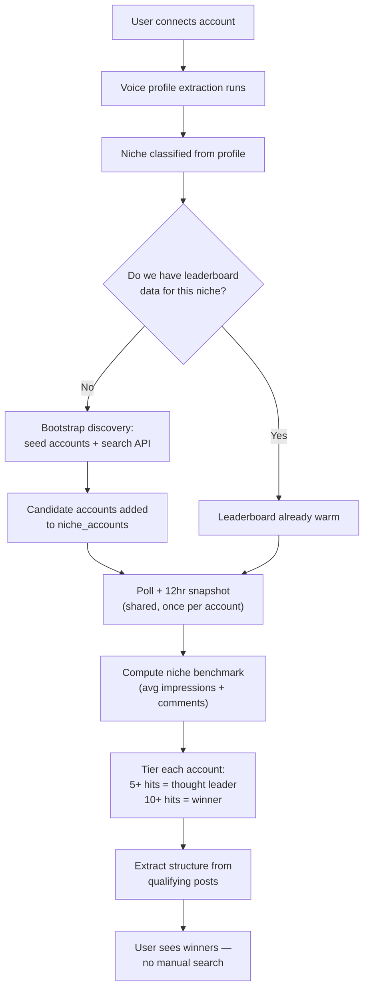

# Social Listening — Technical Spec

What it answers for the user: *who's winning in my niche right now, without me having to go look.*

---

## Flow, end to end



The expensive part (discovery + polling + benchmarking) happens **once per niche**, not once per user. Every user in the same niche reads the same leaderboard.

---

## 1. Niche classification

Happens as a byproduct of voice profile extraction (see `03-voice-profile.md`) — it's not a separate step the user does.

- Input: the voice profile's `niche` field (self-reported in onboarding — "what do you do") plus a pass over the backfilled captions to confirm/refine it.
- **Open question:** fixed taxonomy (e.g. Dev/Tech, Web3, Fitness, Fashion, Finance/Forex, Faith/Ministry, Music, Real Estate, Marketing, Lifestyle) vs. free-text niche with a canonicalization step? Fixed taxonomy keeps the leaderboard joins clean and avoids "dev" / "software developer" / "coder" fragmenting into three empty leaderboards. **Recommend fixed taxonomy for the demo**, confirm with you before building.

## 2. Candidate discovery (bootstrap for a new niche)

Two sources feed the candidate pool for a niche with no data yet:

1. **Seed accounts** — the "who do you look up to on social media" answer from voice-profile onboarding goes straight into this niche's candidate list. This is free and already collected at signup.
2. **Search-based discovery** — a query against a social search API for the niche's keyword(s) (e.g. "web3 developer", "forex trader"), to surface accounts beyond what any one user named.

**Chosen: Xpoz** (confirmed). Covers X, Instagram, Reddit, TikTok under one client — so when the platform set expands past X later, it's the same SDK, not a new integration. 500 free credits to start, no card.

### Wiring it up — step by step

1. **Install + auth**
   ```bash
   pip install xpoz
   ```
   Get a token at `xpoz.ai/get-token`, store as `XPOZ_API_KEY` (env var / secrets manager). The SDK reads it automatically, or pass it directly: `XpozClient(os.environ["XPOZ_API_KEY"])`.

2. **Validate seed accounts** (from voice-profile onboarding's "who do you look up to")
   ```python
   from xpoz import XpozClient, NotFoundError

   client = XpozClient(os.environ["XPOZ_API_KEY"])

   try:
       user = client.twitter.get_user(handle)   # confirms it exists, pulls followers_count
   except NotFoundError:
       # bad handle from onboarding — skip, don't crash the niche bootstrap
       ...
   ```

3. **Bootstrap discovery for a new niche** — `get_users_by_keywords` is built exactly for this: it finds accounts that *authored* posts matching a query, with aggregate engagement already attached.
   ```python
   candidates = client.twitter.get_users_by_keywords(
       '"web3 developer" OR "building on ethereum"',   # niche keyword(s)
       fields=["username", "name", "followers_count",
               "relevant_tweets_count", "relevant_tweets_likes_sum"],
       limit=20,
   )
   # rank by relevant_tweets_likes_sum / relevant_tweets_count, take the top N
   # into niche_accounts as discovered_via="search"
   ```

4. **Poll + snapshot** (Celery Beat task, every 12hr, per `niche_account`) — `get_posts_by_author` with `force_latest=True` both pulls new posts and refreshes engagement on recent ones (impressions/likes/replies grow after posting, so a stale cached read would under-count a post that's still climbing):
   ```python
   posts = client.twitter.get_posts_by_author(
       handle,
       start_date=last_snapshot_date,
       force_latest=True,
       fields=["id", "like_count", "reply_count", "impression_count",
               "retweet_count", "created_at_date"],
       limit=50,
   )
   for post in posts.data:
       store_snapshot(
           niche_account_id,
           post_id=post.id,
           snapshot_at=now(),
           impressions=post.impression_count,   # -> niche_post_snapshots.impressions
           comments=post.reply_count,            # -> niche_post_snapshots.comments
       )
   ```
   `impression_count` and `reply_count` map directly onto the `impressions`/`comments` fields the benchmark math already uses — no translation layer needed.

5. **Credit monitoring** (daily check, cheap call) — matters with 5 niches running ongoing discovery + 12hr polling on free credits:
   ```python
   details = client.account.get_account_details()
   remaining = details.usage.subscription_credits_remaining
   # alert if this drops below a threshold, so polling doesn't silently stop
   ```

6. **One constraint to build around:** `client.twitter_live.*` (the always-fresh, bypass-the-database routes) requires a paid account — free tier gets `AuthenticationError` (403). Everything above uses the regular `client.twitter.*` methods instead, which are database-backed (up to 60-day rolling window) and work fine on free credits. Not a blocker for the demo, just means snapshot freshness is "however recently Xpoz's own crawler hit that account," not truly real-time.

## 3. Polling & snapshotting

- **Cadence:** 12hr snapshot per tracked account.
- **Scope for the demo:** 5 niches, X only.
- **Dedup:** an account is polled once regardless of how many users are in that niche. Store a `niche_accounts` row per (platform, handle) — not per user.
- **Snapshot table:** timestamped, append-only. Post for Me (and the search API above) give lifetime totals, not deltas — so velocity/benchmark math is computed from our own snapshot history, same pattern as the original own-account listening design.

## 4. Benchmark & tiering

- **Benchmark** = average impressions and average comments across all tracked accounts' posts in that niche, **all-time** (confirmed — not a rolling window). The benchmark recalculates as new snapshots come in, but a post that cleared it once stays counted forever; it doesn't age out.
- **"Hit"** = a single post whose impressions **and** comments both clear the current benchmark.
  - **Open question:** AND or OR on impressions/comments? Defaulting to **AND** (has to actually be good on both axes, not just viral-but-silent), flag for confirmation.
- **Tiers:** 5+ lifetime hits = **Thought Leader**. 10+ lifetime hits = **Winner**.

## 5. Structure extraction

You flagged this needs more discussion — here's a starting schema, treat as draft:

```json
{
  "hook_type": "question | stat | bold-claim | story-open | contrarian | other",
  "format": "single | thread | carousel | video",
  "length_bucket": "short | medium | long",
  "media_type": "none | image | video | link",
  "cta_present": true,
  "posted_hour_local": 14
}
```

Extracted only from posts that already qualified as a "hit" (step 4), not every post — keeps extraction volume low and cheap.

## 6. Self-evolving discovery

If a user's classified niche has zero `niche_accounts` rows, step 2's discovery runs immediately for that niche before the user sees anything. Once populated, that niche is warm for every future user who lands in it — the system only "discovers" each niche once.

## 7. Surfacing to the user

No search box, no manual query. On connect (once niche is classified and the leaderboard — existing or freshly bootstrapped — is ready), the user is shown their niche's thought leaders and winners directly.

---

## Data model (draft)

```
niches              (id, label)
niche_accounts       (id, niche_id, platform, handle, external_id, discovered_via[seed|search], added_at)
niche_post_snapshots (id, niche_account_id, post_id, snapshot_at, impressions, comments)
niche_benchmarks     (niche_id, calculated_at, avg_impressions, avg_comments)  -- all-time average, recalculated as snapshots come in
niche_account_tier   (niche_account_id, hits_count, tier[none|thought_leader|winner], updated_at)
post_structures      (post_id, hook_type, format, length_bucket, media_type, cta_present, posted_hour_local)
```

---

## Open questions (summary)

1. Fixed niche taxonomy, or free-text with canonicalization?
2. Which discovery API (options below, in chat) — given none are free at real scale.
3. AND or OR on impressions/comments for a "hit"?
4. Structure schema above — add/cut fields?

~~Benchmark window~~ — resolved: all-time, confirmed.
