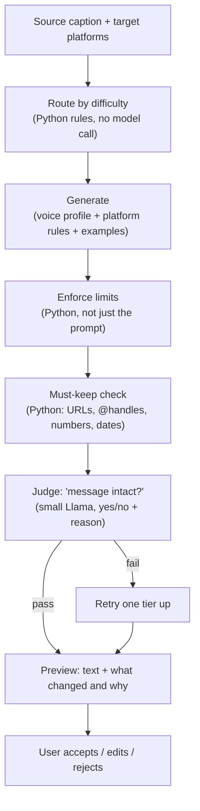

# Caption Repurpose — Technical Spec

What it does: one source caption in, N platform-native versions out — same message, genuinely rewritten, in the user's voice.

**Demo scope: X, LinkedIn, TikTok.** (Trimmed from the full 6-platform list for the hackathon.)

---

## Flow, end to end



## Input / output fields

| Field | In/Out | Notes |
|---|---|---|
| `source_caption` | in | the one draft the user wrote |
| `target_platforms` | in | subset of `["x", "linkedin", "tiktok"]` |
| `voice_profile` | in | from `03-voice-profile.md`, pulled per user |
| `niche_examples` | in (v1.2) | top-performing structures from `01-social-listening.md`'s `post_structures` table — **not wired for the demo**, keep the field reserved so it's a config flip later, not a rewrite |
| `platform` | out | which platform this version is for |
| `adapted_text` | out | the rewritten caption |
| `changes` | out | list of `{change, reason}` — what was changed and why |

## Routing (Python, no model call)

Same three tiers as before — label each (caption, platform) pair by:
- caption length vs. that platform's limit
- links / @mentions / hashtags that must survive
- whether it needs a thread (X specifically)

`easy` → small Llama. `standard` / `hard` → large Llama.

## Platform rules (baked into the prompt)

| | X | LinkedIn | TikTok |
|---|---|---|---|
| Length | ~280 chars visible, thread if longer | 1,300–3,000 chars, hook must land in first 2 lines (truncation point) | Short — caption is secondary to the video |
| Hashtags | 1–2 max | 3–5, placed at the end | 3–5, mix of trend + niche tags |
| Tone | Punchy, short sentences, casual | Professional, line breaks for readability, minimal emoji | Casual, fun, hook-driven |
| CTA style | Reply/RT prompt | "Thoughts?" / comment prompt | "Watch to the end" / comment prompt |

Flag: this table is general knowledge, not pulled from a live source — worth spot-checking against current platform best-practice guides before the demo, and it's exactly the table that's meant to get smarter over time from `01-social-listening.md`'s `post_structures` data (v1.2, not wired yet).

## The system prompt (first draft)

```
You are Lumi's caption adaptation engine. You rewrite one source caption
into a version for {platform}, in this user's own voice, while preserving
the original message exactly.

VOICE PROFILE
{voice_profile_json}

EXAMPLE POSTS (this user, in their own words)
{example_posts}

PLATFORM RULES — {platform}
{platform_rules}

MUST KEEP
- Every URL, @handle, number, date, and named entity in the source caption
  must appear in your output, unchanged.
- The core message and call-to-action of the source caption must survive.

TASK
Rewrite the SOURCE CAPTION below for {platform}. Match the user's voice
(tone, sentence length, emoji use, structure) from the profile and
examples above. Follow the platform rules for length, hashtag use, and
formatting. Do not just trim the source — genuinely rewrite it for how
people read and engage on {platform}.

SOURCE CAPTION
{source_caption}

Return ONLY valid JSON in this shape:
{
  "platform": "{platform}",
  "adapted_text": "...",
  "changes": [
    {"change": "short description of what changed", "reason": "why — tie it to a platform rule or a voice trait"}
  ]
}
```

This is a starting point — once the eval set exists, use it to tighten the wording (especially the MUST KEEP section, which is doing the heaviest lifting against hallucinated rewrites).

## Checks

- **Must-keep (Python):** regex/string match for URLs, @handles, numbers, dates from the source — zero model calls, cheap and deterministic.
- **Judge (small Llama):** "message intact?" yes/no + one-line reason. On fail, retry once one tier up (small → large model). If the judge itself is unavailable, skip it and rely on must-keep alone, flag the caption for review.

## Output to the user

Not just the rewritten text — the `changes` array renders as "what changed and why" under each platform's preview, so the user can sanity-check the rewrite without reading word-by-word.

---

## Deferred to v1.2 (keep in mind, don't build now)

- Blending `niche_examples` (winning structures from social listening) into generation, so the model writes *toward* what's proven to work in the niche, not just toward the user's own voice.
- The `niche_examples` input field above exists in the schema today specifically so this is a prompt-template change later, not a pipeline rewrite.
