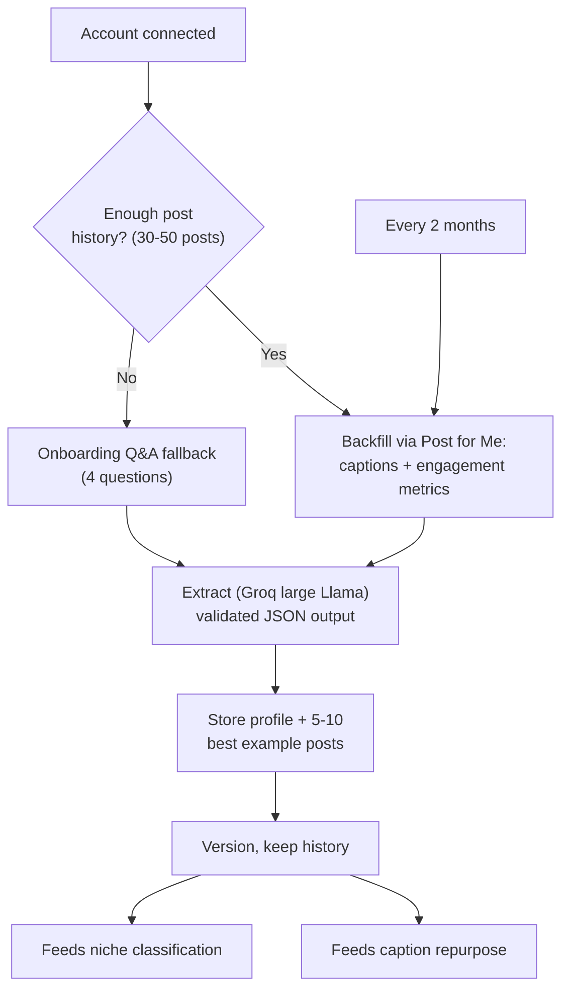

# Voice Profile — Technical Spec

What it does: a stored, versioned model of how one user writes — the thing caption repurpose adapts *toward*, and the thing that feeds niche classification in `01-social-listening.md`.

---

## Flow, end to end



## Input

- **Backfill source:** Post for Me's account feed, last 30–50 posts.
- **Per post, pulled:** caption text **and** engagement metrics (impressions, likes, comments, shares where available) — not captions alone. Engagement is what lets the extraction tell the difference between "this is how they always write" and "this is how they write *when it works*."

## Thin-history fallback (no post history)

Four onboarding questions, asked directly instead of inferred from posts:

1. What do you do / what's your niche?
2. Who do you look up to on social media — who do you want to sound like?
3. Any other socials you want to add?
4. What kind of content do you make or intend to make?

These aren't just voice-profile inputs — question 1 seeds `01-social-listening.md`'s niche classification, and question 2 seeds that niche's candidate-account discovery (seed accounts, zero extra API calls). Worth keeping these four exact questions in sync across both docs since they're load-bearing for two systems, not one.

## Schema (draft — deeper than v0, per your note)

```json
{
  "tone": "string",
  "formality": 0.0,
  "avg_sentence_length": 0,
  "sentence_length_variance": "low | medium | high",
  "emoji_rate": 0.0,
  "emoji_common": ["..."],
  "hook_style": "string",
  "opening_line_patterns": ["..."],
  "closing_sign_off_pattern": "string",
  "vocabulary_signature": ["..."],
  "word_frequency": [{"word": "...", "count": 0}],
  "recurring_keywords": ["..."],
  "structure_patterns": ["..."],
  "writing_pattern": "string",
  "punctuation_habits": ["..."],
  "hashtag_style": "string",
  "cta_style": "string",
  "cta_frequency": 0.0,
  "humor_style": "string",
  "storytelling_vs_listicle": "string",
  "content_pillars": ["..."],
  "niche_angle": "string",
  "posting_time_pattern": ["..."],
  "posting_frequency": "string",
  "never_do": ["..."],
  "topics": ["..."],
  "niche": "string",
  "looks_up_to": ["..."],
  "top_performing_traits": ["..."]
}
```

- `niche` and `looks_up_to` are the fields that bridge straight into `01-social-listening.md` — worth double-checking the field names match exactly what that system reads.
- `top_performing_traits` is new: derived by correlating the pulled engagement metrics against the other fields (e.g. "posts under 2 sentences outperform their average by 2x") — this is the part that needed engagement data, not just captions, to exist at all.
- The fields you asked for directly: `posting_time_pattern` (when they post), `word_frequency` (most-used words), `niche_angle` (what stance/lean they take — contrarian, educational, motivational, data-driven), `writing_pattern` (short punchy lines vs. long-form paragraphs, line-break habits), `recurring_keywords`.
- Additional fields proposed on top of that, same spirit: `opening_line_patterns` and `closing_sign_off_pattern` (how posts start/end), `punctuation_habits` (em-dash use, ALL CAPS, ellipses, exclamation frequency), `humor_style`, `storytelling_vs_listicle` (which format they lean on), `content_pillars` (the handful of topics they actually rotate through, narrower than `topics`), `posting_frequency`, `cta_frequency`.

This is the real depth pass — flag anything here that's noise, or anything still missing.

## Extraction

- **Model:** large Llama on Groq's free tier (same as before — no change here).
- **Output:** validated JSON (pydantic), retry once on validation failure, then fail loudly rather than store garbage.
- **Store:** the profile plus 5–10 best example posts (by engagement), used directly as few-shot examples in caption repurpose.

## Versioning & re-extraction

- **Versioned from day one** — every extraction creates a new version, old ones kept, so a bad update can be rolled back.
- **Cadence: every 2 months**, scheduled — confirmed, no manual trigger for now. (If a user changes style mid-cycle and that turns out to matter in practice, a manual "refresh my voice" button is a cheap one-Celery-task addition later — not building it now since it wasn't asked for.)

---

## Open questions (summary)

1. Confirm the expanded schema above, or point at specific traits still missing/noise.
